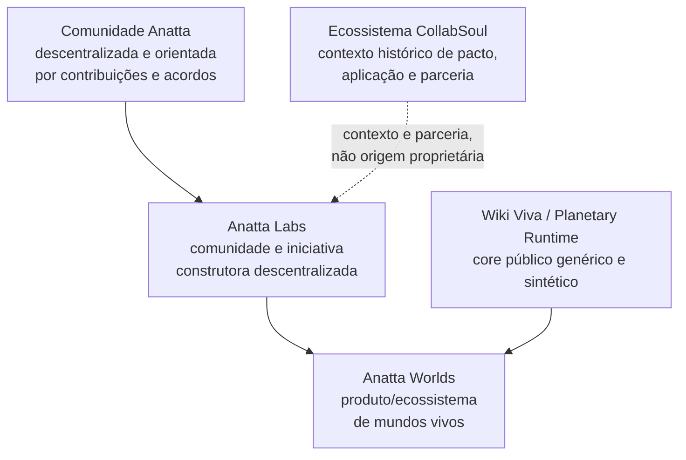

# Anatta Worlds — Game Design Document 3.0

**Anatta Labs · Anatta Worlds**  
**Codinome técnico do core:** Wiki Viva · Planetary Runtime  
**Versão:** 3.0-draft · 2026-07-27  
**Idioma canônico:** português do Brasil  
**Estado:** rascunho versionável para revisão humana  
**Publicação:** não autorizado para release, push, PR ou apresentação externa  

> **Anatta Worlds é o produto/ecossistema de mundos vivos desenvolvido pela
> Anatta Labs.** Fontes
> autorizadas transformam acontecimentos reais em matéria rastreável; módulos
> aplicam lentes explícitas; tensões podem virar missões; ações humanas e de
> agentes produzem evidência; somente gates humanos promovem significado,
> decisão e mudança durável no mundo.

Este documento recria o GDD 3 com uma narrativa histórica corrigida. Ele não
reescreve a história para produzir uma origem mais simples do que a evidência
permite. Preserva o que continua válido no
[GDD 2.0](GDD.md), na
[pesquisa de game loops](research/game-loops-2026-07-23.md), nos contratos do
Planetary Runtime e no rascunho local anterior do GDD 3.0, mas substitui
afirmações de identidade, origem, operação e maturidade que confundiam
iniciativa, plataforma, produto, parceria e entrega.

**Nota de escopo:** este GDD descreve história, identidade e produto. Ele não
define CNPJ, percentuais, direitos societários ou titularidade de propriedade
intelectual; nenhuma dessas condições deve ser inferida quando não houver
contrato específico citado.

---

## 0. Como ler e revisar

### 0.1 Marcas de maturidade

| Marca | Significado neste documento |
| --- | --- |
| **HISTÓRIA** | acontecimento ou relação passada preservada com seus limites |
| **VISÃO** | direção desejada; ainda pode mudar por decisão humana |
| **CONTRATO** | invariante do produto/core que uma implementação deve respeitar |
| **DEMO** | menor prova sintética prevista; não equivale a produto entregue |
| **POC** | viabilidade técnica isolada; não equivale a integração |
| **EM VALIDAÇÃO** | mecânica ou feature candidata, ainda sem evidência suficiente |
| **ABERTO** | questão sem decisão suficiente |
| **SUPERADO** | interpretação anterior preservada no histórico, mas sem autoridade atual |

### 0.2 Cinco superfícies que não podem ser misturadas

| Superfície | Pergunta | Autoridade |
| --- | --- | --- |
| visão | o que queremos tornar possível? | direção de produto |
| contrato | o que toda implementação precisa preservar? | invariantes |
| demo | o que será provado agora, com escopo e dados sintéticos? | evidência limitada |
| operação atual | quem trabalha, financia e decide hoje? | fatos operacionais atuais |
| evolução | quais mecânicas/features ainda precisam de teste? | hipótese de produto |

Uma imagem, um protótipo, uma conversa histórica, uma parceria e uma operação
cotidiana não são o mesmo tipo de evidência.

### 0.3 Ordem de autoridade

Quando houver divergência:

1. correções diretas mais recentes do responsável atual pela operação;
2. registros primários e decisões humanas verificáveis;
3. este GDD após revisão humana;
4. contratos públicos genéricos do Wiki Viva/Planetary Runtime;
5. GDD 2.0, planos e pesquisas ainda compatíveis;
6. POCs e demos como evidência limitada;
7. narrativas e imagens superadas como registro histórico.

---

## 1. Origem, continuidade e limites históricos

### 1.1 O encontro de 2023

**HISTÓRIA**

O encontro de 2023 é tratado neste GDD como um **pacto e uma proposta de
organização tecnológica descentralizada dentro do ecossistema CollabSoul**.
Ele registra intenção, afinidade e horizonte de colaboração.

O encontro não é usado para inferir CNPJ, percentuais, direitos societários,
propriedade intelectual ou obrigações não citadas. Seu significado neste GDD é
histórico e organizacional: um pacto de colaboração e uma direção tecnológica.

### 1.2 O que “Anatta Labs” significa neste GDD

**IDENTIDADE PRESENTE**

Anatta Labs é a **comunidade e iniciativa construtora descentralizada** que
conecta pesquisa, tecnologia, produtos, práticas e contribuições. Ela atua no
presente por meio das pessoas, produtos, artefatos, decisões e relações que a
constroem.

Descentralização aqui significa capacidade de contribuir, propor, revisar,
criar módulos e participar de missões dentro de papéis e grants explícitos.
Não significa ausência de responsabilidade, gate ou autoria.

### 1.3 Operação atual e relações históricas

**OPERAÇÃO ATUAL**

O desenvolvimento, a operação técnica e o investimento corrente são conduzidos
pelo usuário responsável por este projeto, no âmbito da Anatta Labs.

Marcelo e Michelle possuem relação histórica com a iniciativa e podem participar
por acordos próprios. No recorte operacional atual deste GDD, eles não conduzem
nem financiam o trabalho diário. O documento não inventa percentuais, direitos
ou obrigações para nenhuma pessoa.

### 1.4 De Mundos Vivos para Anatta Worlds

**PRODUTO**

“Mundos Vivos” foi o nome usado durante a exploração do produto e continua
válido como termo histórico e como descrição de uma categoria de experiência.
O produto desta direção passa a ser chamado **Anatta Worlds**.

Anatta Worlds:

- é o produto/ecossistema de mundos vivos desenvolvido pela Anatta Labs;
- não é apresentado como o primeiro produto da Anatta;
- sucede a exploração “Mundos Vivos” sem apagar seus aprendizados;
- usa uma arquitetura capaz de suportar muitos mundos;
- não transforma o core público genérico em software proprietário de uma única
  marca ou história privada.

---

## 2. Modelo de iniciativa, produtos e contextos



### 2.1 Fronteira do core público

**CONTRATO**

O core público deve permanecer genérico:

- primitivas como `World`, `Planet`, `Source`, `Snapshot`, `Module`,
  `Perspective`, `Mission`, `Decision`, `Grant` e `Receipt`;
- fixtures sintéticas, sem dados pessoais, privados ou societários;
- configuração por produto e por mundo;
- nenhuma regra de domínio dependente dos nomes Anatta ou CollabSoul;
- nenhuma inferência de direitos societários, propriedade intelectual ou
  autoridade a partir de configuração técnica;
- downstreams privados podem aplicar identidade e dados próprios sem alterar o
  contrato comum.

Anatta Worlds é uma implementação/produto sobre esse core, não a definição de
todo uso possível do core.

---

## 3. Resumo executivo do jogo

Pessoas, equipes e comunidades produzem documentos, conversas, compromissos,
decisões, dados e artefatos em volume maior do que conseguem transformar em
entendimento e ação. Agentes podem processar esse material, mas sem contexto,
proveniência, autoridade e revisão tendem a misturar evidência, interpretação
e decisão.

Anatta Worlds propõe o seguinte circuito:

```text
VIDA
  → FONTES AUTORIZADAS
    → EVIDÊNCIA PRESERVADA
      → MÓDULOS / LENTES
        → PROJEÇÕES, CONTRASTES E LACUNAS
          → TENSÕES
            → MISSÕES POSSÍVEIS
              → AÇÃO HUMANA OU DE AGENTE
                → NOVA EVIDÊNCIA
                  → GATE HUMANO
                    → RECEIPT
                      → CONSEQUÊNCIA REAL E MUNDO ALTERADO
```

O produto organiza contexto, fontes, módulos, permissões, propostas e receipts.
O jogo torna esse sistema habitável: cria lugar, ritmo, feedback, memória,
escolha, autoria e consequência.

### 3.1 North Star

> Uma pessoa abre seu mundo e entende: qual intenção o organiza, o que mudou,
> de onde veio, que perspectivas estão lendo a situação, qual tensão importa,
> que missão real pode processá-la, o que um agente pode propor e o que depende
> de decisão humana.

### 3.2 O que torna isto um jogo

- uma intenção define um futuro possível;
- o mundo nasce pequeno, útil e incompleto;
- fontes mantêm sua ecologia viva;
- lentes revelam interpretações distintas sem se tornarem verdade;
- escolhas possuem consequência fora da tela;
- missões produzem evidência, não apenas checkmarks;
- o mundo muda quando um estado real muda;
- módulos adicionam capacidades;
- a história acumula sem reset ou culpa;
- pessoas podem criar e compartilhar novas formas de jogar.

### 3.3 Não objetivos desta fase

- definir CNPJ, percentuais, direitos societários ou propriedade intelectual;
- apresentar Anatta Worlds como produto lançado;
- criar metaverso, MMO ou rede social de avatares;
- substituir análise, decisão ou consentimento humano por IA;
- usar imagens de POC como evidência de implementação;
- acoplar o core público à narrativa privada da iniciativa.

---

## 4. Princípios de design

### 4.1 Nenhum pixel mente

**CONTRATO**

Toda marca visível relevante deve resolver para:

- dado, evento ou estado tipado;
- fonte, snapshot ou receipt;
- regra/módulo que determinou a representação;
- `dataRef` ou referência equivalente;
- alternativa textual e superfície 2D verificável.

Decoração pode existir, mas não pode fingir atividade, urgência, consenso,
causalidade ou maturidade.

### 4.2 Perspectiva não é verdade

O sistema mantém distintos:

```text
dado → evidência → interpretação → claim → tensão → decisão → receipt
```

Um módulo declara sua lente, versão, inputs e limites. Divergência pode
permanecer visível. Convergir não é apagar dissenso nem calcular média.

### 4.3 Agentes movem matéria; humanos concedem significado e autoridade

Agentes podem localizar, extrair, comparar, simular, redigir, implementar e
propor. Aprovação, publicação, decisão pessoal, concessão de acesso e mudança
de memória canônica permanecem humanas quando a política exigir.

### 4.4 Módulo é capacidade, não enfeite

Instalar um módulo muda o que o mundo consegue:

- ler;
- interpretar;
- representar;
- perguntar;
- propor;
- executar dentro de grants;
- verificar;
- devolver como receipt.

Uma construção sem capacidade ou efeito verificável é cenário, não módulo.

### 4.5 O jogo acontece no mundo real

Fechar a interface para conversar, estudar, criar, cuidar, decidir ou executar
uma missão é parte do jogo. Tempo de tela não é objetivo.

### 4.6 Ausência não cria dívida

Sem streak punitivo, morte por negligência ou urgência fabricada. Fontes podem
ficar stale, módulos podem hibernar e tensões podem ser compostadas. O retorno
mostra um diff compreensível e acolhedor.

### 4.7 Conexão não é acesso

Conexão entre mundos não concede leitura, escrita, autoridade ou publicação.
Grants são escopados, temporais, revogáveis e negados por padrão.

---

## 5. Fontes, evidência e verdade operacional

### 5.1 O que é uma fonte

Uma fonte é uma origem viva com identidade, owner, política, receita de leitura,
estado, frescor e histórico de snapshots. Documento, conversa, agenda, sensor,
planilha, repositório ou pessoa podem atuar como fonte sob contratos diferentes.

### 5.2 Caminho de dados

```text
SOURCE
  → SNAPSHOT IMUTÁVEL
    → EXTRAÇÃO/NORMALIZAÇÃO
      → LEITURA CONTEXTUAL, QUANDO NECESSÁRIA
        → PROJEÇÃO DE MÓDULO
          → CLAIM/TENSÃO CANDIDATA
            → PROPOSTA
              → GATE
                → DECISÃO/RECEIPT
```

### 5.3 Regras

- raw não é silenciosamente alterado;
- uma derivação aponta para inputs verificáveis;
- tempo do acontecimento e tempo do registro permanecem distintos;
- “não encontrado” não é “não existe”;
- inferência declara confiança e alternativa;
- replay não é inventado entre pontos sem evidência;
- dado privado não entra na demo pública;
- acesso secreto nunca é persistido.

### 5.4 Fontes narrativas deste GDD

| Evidência | Papel | Limite |
| --- | --- | --- |
| correção direta do owner em 2026-07-27 | fonte nuclear para origem, operação atual e renomeação | precisa ser capturada em decisão versionada antes de aprovação final |
| [GDD 2.0](GDD.md) | loops, superfícies, módulos, fontes, agentes e personalização | sua linhagem de 2025 não explica todo o contexto de 2023 nem os limites jurídicos |
| rascunho local anterior do GDD 3.0 | contratos de verdade visual, comunidade, economia, demo e maturidade | não estava versionado nesta frente e usava “Mundos Vivos” como identidade corrente |
| plano vNext de 2026-07-18 | primitivas, proveniência, capabilities, federação e ordem prototype-first | consultado em outra frente local; ainda não é fonte versionada desta branch |
| [pesquisa de game loops](research/game-loops-2026-07-23.md) | loops saudáveis, anti-grind, consequência e exit ramps | sustenta design; não prova aceitação de mercado |
| POCs e storyboards locais | viabilidade e falhas visuais/técnicas | não provam produto integrado, operação ou aprovação |

### 5.5 Lacunas de proveniência

Antes de aprovar este GDD, a revisão deve:

1. versionar um registro curto da decisão editorial de 2026-07-27;
2. apontar os registros primários do pacto de 2023;
3. separar evidência histórica, produto e contexto de parceria;
4. confirmar a formulação pública aceitável sobre Anatta Labs e CollabSoul;
5. decidir quais nomes de pessoas podem aparecer em versão externa;
6. manter afirmações sobre direitos fora do texto quando não houver contrato citado.

---

## 6. Módulos e lentes

### 6.1 Contrato mínimo

Todo módulo declara:

- identidade, versão, owner e licença;
- propósito e perguntas que sabe fazer;
- fontes e tipos que lê;
- outputs e claims que pode propor;
- gramática visual/2D;
- missões e comandos possíveis;
- capabilities e proibições;
- fixtures e critérios de teste;
- custos, performance e fallback;
- lifecycle, migração e remoção;
- política de proveniência e privacidade.

### 6.2 Lifecycle

```text
DESCOBRIR
  → ADICIONAR
    → ATIVAR COM PRÉ-REQUISITOS
      → OPERAR
        → EVOLUIR POR OUTCOMES
          → HIBERNAR
            → REMOVER SEM APAGAR DADOS
```

Módulos não evoluem por número de cliques. Evoluem por outcomes verificáveis:
evidência melhor, tensão processada, ação real, decisão compreendida ou
capacidade criada.

### 6.3 Módulos de referência

| Módulo/lente | Capacidade | Consequência possível |
| --- | --- | --- |
| Proveniência | rastrear origem, impacto e fechamento | bloquear claim sem base ou abrir revisão |
| Hidrografia | transformar estados em bacias, fluxos e margens | revelar acúmulo, bloqueio e caminhos |
| Clima | representar condição temporal atual | alterar atmosfera apenas enquanto o dado sustenta |
| Integral/AQAL | comparar quadrantes e perspectivas | evidenciar ausência ou tensão entre leituras |
| Aprendizagem | ligar conteúdo, prática e competência | propor missão de aplicação e pedir evidência |
| Projeto/Team OS | relacionar decisões, dependências e ações | gerar proposta com owner, gate e receipt |
| Praça Pública | processar contribuições e divergências | manter dissenso, facilitar deliberação e registrar decisão |

São referências coexistentes. Nenhuma é obrigatória para todo mundo.

---

## 7. Tensões, missões e consequências reais

### 7.1 Tensão

Tensão é a percepção do intervalo entre realidade atual e potencial. Não é
automaticamente problema, tarefa, urgência ou decisão.

### 7.2 Contrato de missão

Uma missão precisa declarar:

- tensão de origem;
- resultado real desejado;
- ação dentro e/ou fora da tela;
- responsável e colaboradores;
- evidências aceitas;
- fontes que podem observar retorno;
- agente e capabilities, se houver;
- risco, custo e prazo importados da realidade;
- gate e autoridade;
- estados de falha, recusa e compostagem;
- mudança esperada no mundo;
- formato do receipt.

### 7.3 Escolhas do jogador

1. fazer;
2. delegar;
3. pedir evidência;
4. compostar sem culpa.

### 7.4 Consequência

Uma missão não termina porque uma caixa foi marcada. Ela termina quando há
evidência suficiente para um gate produzir um receipt ou registrar honestamente
por que não houve resultado.

Consequências podem incluir:

- fonte atualizada;
- claim aceito, corrigido ou rejeitado;
- decisão registrada;
- relação criada ou revogada;
- capability concedida ou removida;
- módulo ativado, evoluído ou hibernado;
- alteração localizada na geografia;
- nova tensão;
- nenhuma mudança, com razão explícita.

---

## 8. Ritmos e loops

### 8.1 MICRO — sessão voluntária

```text
chegar → ver o diff → focar até 3 tensões → decidir/delegar/compostar
  → receber feedback → encerrar com receipt de sessão
```

A sessão-alvo é de 5–10 minutos. P95 acima de 20 minutos é sinal de investigação,
não vitória.

### 8.2 MESO — dias

- fontes atualizam, falham ou ficam stale;
- módulos sinalizam apetite sem cobrar;
- missões avançam e retornam com evidência;
- agentes trabalham de modo observável;
- gates humanos processam propostas;
- o mundo preserva consequências.

### 8.3 MACRO — estações e épocas

O acúmulo qualitativo pode levar o mundo a propor uma transição de época. O
guardião decide. A época anterior se torna camada histórica, não é apagada.

### 8.4 Loop de criação

```text
observar necessidade → criar/adaptar módulo → testar em fixtures
  → publicar em escopo permitido → jogar → observar outcomes
    → corrigir → versionar ou retirar
```

---

## 9. Mundo, superfícies e arquitetura de plataforma

### 9.1 Um produto, várias superfícies

| Superfície | Pergunta |
| --- | --- |
| mundo/planeta | como está o organismo e o que mudou? |
| atlas/mapa 2D | como entidades, estados e relações se conectam? |
| interior | como operar uma capacidade a fundo? |
| timeline | o que aconteceu, quando foi registrado e o que afetou? |

3D e 2D representam o mesmo estado semântico. O 2D é primeira classe e serve
como verificação, acessibilidade e precisão.

### 9.2 Muitos mundos

**CONTRATO**

A arquitetura suporta mundos pessoais, de projeto, organização, comunidade ou
produto. Cada mundo possui intenção, owner, política, namespace, fontes,
módulos e grants próprios.

Um portal pode oferecer projeção segura, pedido de acesso ou módulo. Nenhum
mundo escreve diretamente em outro. O receptor aceita, limita, rejeita ou
revoga.

### 9.3 Anatta Worlds dentro da plataforma

Anatta Worlds é uma configuração autoral que pode reunir:

- identidade e intenção Anatta;
- módulos/lentes escolhidos;
- missões e rituais;
- comunidade e governança;
- linguagem visual própria;
- produtos ou mundos relacionados por grants.

O mesmo core público deve continuar servindo configurações não-Anatta.

---

## 10. Comunidade descentralizada

### 10.1 Comunidade como prática

Comunidade é um sistema de intenção, papéis, contribuições, evidência,
contraditório, cuidado, manutenção, aprendizagem, sustentabilidade e saída.
Não é apenas feed, presença simultânea ou coleção de avatares.

### 10.2 Papéis possíveis

| Papel | Responsabilidade | Limite |
| --- | --- | --- |
| responsável operacional atual | produto, técnica, investimento e gates correntes | não amplia direitos por ato do produto |
| contributor | propõe e executa dentro de capabilities | não amplia o próprio escopo |
| player | realiza missões e produz evidência | não promove verdade sem gate |
| facilitator | conduz jornadas e conflitos | não substitui autoridade declarada |
| game maker | desenha regras e ritmos | autoria não concede acesso |
| reviewer/curator | verifica origem, qualidade e impacto | não apaga dissenso |
| partner | oferece método, serviço ou contexto | parceria não implica propriedade |
| agent | processa e propõe dentro de grant | não decide por pessoas |
| visitor | navega projeção permitida | não lê raw privado |

Marcelo e Michelle permanecem no registro histórico e podem participar por
acordos próprios, sem serem apresentados como operação diária atual.

### 10.3 Governança

Cada regra, módulo, missão e decisão relevante deve tornar visíveis:

- propósito e owner;
- quem pode propor e quem pode decidir;
- escopo, duração e revogação;
- como contestar;
- como registrar dissenso;
- como revisar impacto;
- como manter e financiar trabalho;
- como sair sem perder a história legítima.

### 10.4 Acordos e responsabilidades

Papéis comunitários e operacionais precisam de propósito, escopo, owner, prazo,
grant, possibilidade de revogação e receipt. O GDD não converte contribuição em
direito societário, propriedade intelectual ou obrigação não declarada.

---

## 11. Economia de contribuição e sustentabilidade

### 11.1 Visão

A economia de contribuição reconhece trabalho útil como:

- criação e manutenção de módulos;
- curadoria e verificação;
- facilitação;
- produção de fontes e evidências;
- implementação;
- cuidado comunitário;
- documentação;
- pesquisa;
- suporte e operação;
- resolução de missões.

O sistema pode registrar contribuição, contexto, autoria, impacto, aceite e
receipt. A comunidade pode então reconhecer trabalho, cuidado e manutenção com
regras compreensíveis, auditáveis e alinhadas à sua sustentabilidade.

### 11.2 Princípios

- contribuição registrada não cria automaticamente autoridade ou direitos;
- critérios de reconhecimento são declarados antes da avaliação;
- criação, cuidado, curadoria e manutenção permanecem visíveis;
- qualidade e impacto importam mais do que volume ou atenção;
- decisões possuem owner, contraditório e possibilidade de revisão;
- entrada, mudança de papel e saída preservam dignidade e história;
- custos e dependências operacionais permanecem transparentes;
- a sustentabilidade serve a continuidade da comunidade e de seus produtos.

### 11.3 Validação

**EM VALIDAÇÃO**

Antes de adotar uma regra de reconhecimento ou sustentabilidade, a comunidade
deve testar:

- que problema ela resolve;
- que comportamento incentiva ou desencoraja;
- como qualidade, impacto e cuidado são verificados;
- quem pode propor, decidir, revisar e revogar;
- como conflitos e erros são corrigidos;
- como participantes compreendem a regra;
- como a regra pode ser pausada, alterada ou encerrada;
- quais requisitos legais, éticos, operacionais e de segurança se aplicam;
- se um piloto limitado produziu efeitos coerentes com a intenção.

---

## 12. Demo vertical slice

### 12.1 Objetivo

**DEMO**

Provar com dados sintéticos que:

1. uma intenção e uma fonte podem fazer nascer um mundo pequeno;
2. fontes sustentam mudanças rastreáveis;
3. duas ou mais lentes produzem leituras distintas;
4. uma tensão pode virar missão real;
5. agente propõe e humano decide;
6. receipt precede mutação durável;
7. módulo muda capacidade, não decoração;
8. mundo, 2D, interior e timeline preservam o mesmo estado;
9. um portal respeita grant e revogação;
10. a identidade Anatta Worlds vive na configuração, não no microkernel.

### 12.2 Roteiro

| Ato | Prova |
| --- | --- |
| 1. intenção | o mundo nasce pequeno e legível |
| 2. fontes | snapshots criam um diff verificável |
| 3. lentes | módulos divergem sem reescrever evidência |
| 4. tensão | o sistema explica por que ela existe |
| 5. missão | pessoa escolhe fazer, delegar, pedir evidência ou compostar |
| 6. retorno | ação fora da tela produz nova fonte |
| 7. gate | origem, impacto, autoridade e alternativas ficam visíveis |
| 8. receipt | decisão e consequência são registradas |
| 9. mundo | geografia muda apenas onde o dado autoriza |
| 10. fronteira | outro mundo pede acesso; grant é limitado e revogável |

### 12.3 Fora do escopo da demo

- dados pessoais;
- questões jurídicas ou societárias fora do escopo do produto;
- prova de sociedade ou participação;
- multiplayer em tempo real;
- código remoto arbitrário de módulo;
- automação de publicação;
- direção visual definitiva;
- afirmação de produto pronto.

---

## 13. Estado de implementação

| Camada | Estado deste GDD |
| --- | --- |
| narrativa Anatta Labs/Anatta Worlds/CollabSoul | corrigida para revisão |
| contratos de fontes, módulos, missões e receipts | direção consolidada; implementação parcial no ecossistema Wiki Viva |
| Planetary Runtime | POCs e protótipos locais; não prova produto integrado |
| Anatta Worlds como produto | GDD e POCs; não lançado |
| Anatta Labs | comunidade/iniciativa presente; governança de produto em evolução |
| economia de contribuição e sustentabilidade | visão e princípios em validação |
| federação de mundos | contrato alvo; precisa de vertical slice |
| core público genérico | requisito obrigatório |

---

## 14. Ledger de supersessões

| Formulação anterior | Estado | Formulação corrente |
| --- | --- | --- |
| “Mundos Vivos” como nome corrente do produto | **SUPERADO** | Anatta Worlds; “Mundos Vivos” permanece histórico/categoria |
| Anatta Labs como apenas um nome retrospectivo | **SUPERADO** | comunidade/iniciativa construtora presente e descentralizada |
| encontro de 2023 como origem jurídica ou proprietária | **SUPERADO** | pacto e proposta descentralizada no ecossistema CollabSoul |
| Marcelo e Michelle como operação/financiamento diário presumido | **SUPERADO** | relação histórica e participação por acordos próprios; sem operação diária atual |
| CollabSoul como origem proprietária de Anatta Worlds | **SUPERADO** | contexto histórico de pacto e parceria; Anatta Labs desenvolve Anatta Worlds |
| Anatta Worlds como primeiro produto Anatta | **SUPERADO** | produto/ecossistema desenvolvido diretamente pela Anatta Labs |
| módulo como prédio atraente | **SUPERADO** | capacidade completa com inputs, outputs, ações e consequências |
| pixel decorativo como dado | **SUPERADO** | marca sem `dataRef` não pode fingir verdade operacional |
| perspectiva como verdade | **SUPERADO** | projeção versionada, contestável e separada da evidência |
| demo como produto pronto | **SUPERADO** | prova sintética limitada por gates |
| vídeo como navegação operacional | **SUPERADO** | navegação direta; mídia apenas quando tiver função e fallback |
| 3D como requisito do core | **SUPERADO** | renderer substituível; 2D é primeira classe |

---

## 15. Roadmap por aprendizagem

### P0 — revisão narrativa

- validar este GDD com as pessoas necessárias;
- registrar a correção do owner como decisão versionada;
- validar formulações públicas sobre 2023, CollabSoul e Anatta Labs;
- confirmar o vocabulário direto Anatta Labs → Anatta Worlds.

### P1 — contratos da demo

- congelar fixture sintética;
- definir duas lentes, uma missão e um portal;
- definir receipts e estados de falha;
- aprovar matriz de verdade visual.

### P2 — evidence kernel

- Source, Snapshot, Claim, Projection, Mission, Decision, Grant e Receipt;
- tempo do evento, registro, ingestão e verificação;
- recompilação determinística;
- redaction e auditoria.

### P3 — world compiler

- dicionário mínimo dados → geografia;
- paridade 2D/3D;
- `dataRef` em toda marca operacional;
- conflitos de canal e fallback.

### P4 — missão real

- missão fora da tela;
- agente em proposal mode;
- gate parcial;
- receipt;
- consequência localizada.

### P5 — módulos e creator

- lifecycle completo;
- manifesto auditável;
- fixtures;
- preview e diff;
- remoção sem perda de dados.

### P6 — comunidade e federação

- papéis e grants;
- dissenso e apelação;
- portal entre mundos;
- revogação;
- piloto de contribuição e receipts com regras explícitas.

### P7 — sustentabilidade e escala

- validar produto e demanda;
- acordos claros para papéis e contribuições;
- testar regras de reconhecimento e sustentabilidade em escopo limitado;
- validar segurança, governança, reversibilidade e requisitos aplicáveis;
- tornar custos, responsabilidades e manutenção transparentes;
- governança e resolução de conflitos.

---

## 16. Questões para revisão humana

### 16.1 Narrativa e identidade

1. “Comunidade e iniciativa construtora descentralizada” descreve Anatta Labs com precisão suficiente?
2. Que evidência primária de 2023 pode ser citada em versão interna e externa?
3. Em que contextos “Mundos Vivos” deve permanecer como subtítulo ou categoria?
4. Quais nomes de pessoas devem aparecer numa versão pública?

### 16.2 Produto

5. Qual caso âncora deve conduzir a primeira demo?
6. Quais duas lentes provam melhor que perspectiva não é verdade?
7. Qual consequência real é pequena, segura e visualmente inequívoca?
8. Que parte da identidade Anatta Worlds pertence ao kit/configuração?
9. O que precisa continuar estritamente genérico no core público?

### 16.3 Comunidade e economia

10. Quais papéis existem hoje, de fato, além do responsável operacional?
11. Como reconhecer contribuição, cuidado e manutenção de forma compreensível?
12. Que regra de sustentabilidade deve ser testada primeiro?
13. Que contribuições e papéis exigem acordo explícito antes da operação?
14. Que mecanismos de segurança, apelação, reversão e saída são obrigatórios?

### 16.4 Validação

15. Qual evidência separa demo compreendida de demo apenas bonita?
16. Qual é o gate para passar de visão a contrato?
17. Qual é o gate para passar de contrato a piloto?
18. Que afirmações devem falhar automaticamente na revisão editorial?

---

## 17. Definition of Done deste rascunho

Este GDD estará pronto para sair de `draft` somente quando:

- a narrativa de 2023 estiver ligada a evidência suficiente;
- nenhuma frase inventar CNPJ, percentuais, direitos societários ou propriedade intelectual;
- operação diária e relações históricas estiverem separadas;
- Anatta Worlds estiver descrito como produto/ecossistema desenvolvido pela Anatta Labs;
- comunidade e governança tiverem papéis, limites e direito de saída;
- fontes, módulos, missões e consequências forem testáveis;
- economia de contribuição declarar princípios, gates e estado de maturidade;
- regras de sustentabilidade declararem utilidade, segurança, governança,
  reversibilidade e requisitos aplicáveis antes da adoção;
- visão, contrato, demo, operação e evolução estiverem identificados;
- supersessões estiverem explícitas;
- o core público continuar genérico e sintético;
- revisão humana registrar aceite, correções ou rejeição.

---

## Apêndice A — Vocabulário controlado

| Termo | Uso neste documento |
| --- | --- |
| Anatta Labs | comunidade/iniciativa construtora presente e descentralizada |
| Anatta Worlds | produto/ecossistema de mundos vivos desenvolvido pela Anatta Labs |
| Mundos Vivos | nome histórico da exploração e descrição da categoria |
| CollabSoul | ecossistema de contexto, aplicação e parceria |
| core público | toolkit genérico, sintético e configurável |
| comunidade | prática descentralizada com papéis, contribuições, gates e saída |
| contribuição | trabalho/evidência registrada que pode sustentar reconhecimento e continuidade |
| módulo | capacidade versionada que aplica uma lente e pode produzir ações |
| missão | opção estruturada de ação com resultado, evidência, gate e receipt |
| receipt | registro tipado de resultado, decisão e impacto |

## Apêndice B — Regra editorial automática

Reprovar qualquer versão que afirme, sem fonte e contrato:

- qualquer CNPJ, percentual, direito societário ou titularidade de IP não citados;
- “Marcelo e Michelle são sócios”;
- “Marcelo e Michelle operam ou financiam atualmente”;
- “Anatta Worlds é o primeiro produto da Anatta”;
- “a demo prova o produto”;
- “o core público pertence a uma única marca ou mundo”.

---

**Fim do rascunho do GDD 3.0 — revisão humana obrigatória.**
