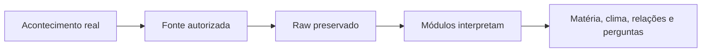
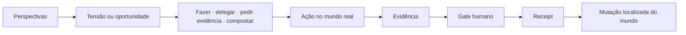
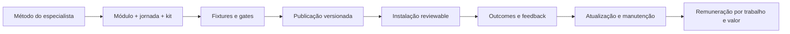
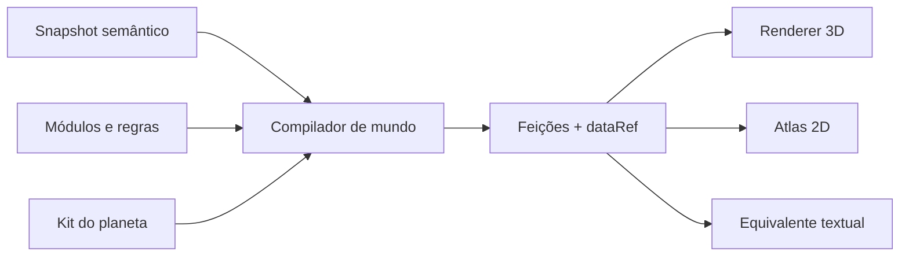
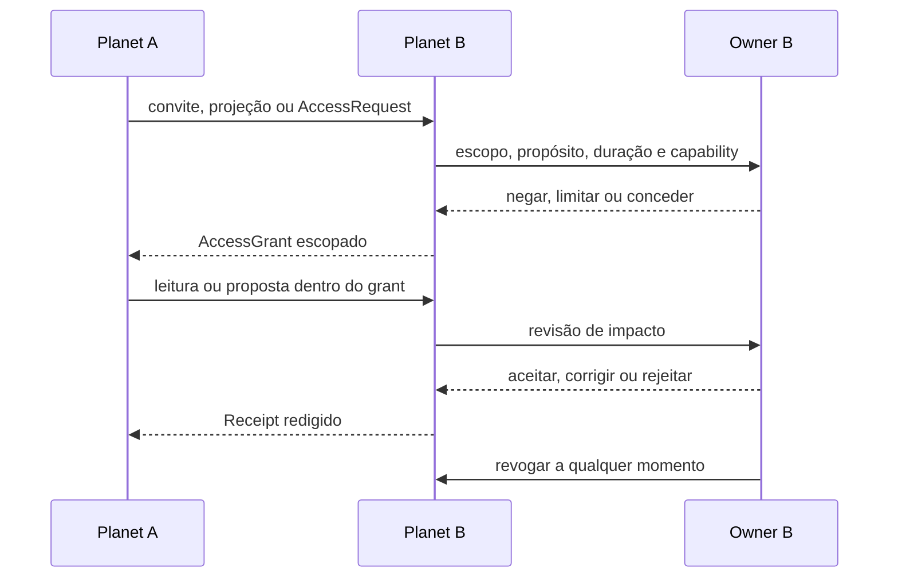
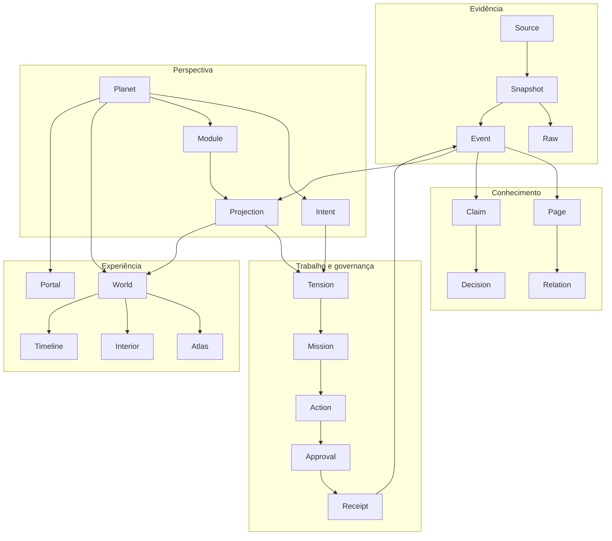

# Mundos Vivos — Game Design Document 3.0

> **Nota histórica:** derivado textual de uma proposta de 26/07/2026, com origem no commit local `a1459090e`. Referências não públicas foram generalizadas e exemplos de pessoa são sintéticos. Este registro não comprova implementação, aceite atual, titularidade ou liberação de produto.

**Wiki Viva · Planetary Runtime**<br>
**Versão:** 3.0 · 2026-07-26<br>
**Idioma canônico desta edição:** português do Brasil<br>
**Estado:** direção de produto consolidada para revisão; não é aprovação de
arquitetura, direção visual, economia ou release<br>
**Papel:** este documento guia o produto, o storyboard e a próxima demo. O
protótipo prova viabilidade; ele não define a visão.

> **Mundos Vivos é um jogo jogado no mundo real.** Fontes transformam a vida
> em matéria viva; módulos interpretam essa matéria e propõem missões; pessoas
> e agentes atuam dentro e fora da tela; evidências retornam pelas fontes e,
> depois de revisão humana, fazem o mundo, os módulos e a própria intenção
> evoluírem.

---

## Como ler este documento

Para uma leitura executiva de 20 minutos, leia as seções 1 a 8. Para desenho de
produto e experiência, continue até a seção 24. Para implementação, produção e
governança, use as seções 25 a 33 e os apêndices.

### Mapa do documento

| Bloco | Conteúdo |
| --- | --- |
| [Estratégia e jogo](#1-resumo-executivo) | seções 1–8: tese, problema, fantasia, princípios, antiobjetivos, loops e ritmos |
| [Sistema vivo](#9-modelo-de-mundo) | seções 9–18: mundo, ontologia, fontes, compilador, geografia, módulos, missões, agentes e receipts |
| [Coletivo e economia](#19-comunidade-e-jogo-coletivo) | seções 19–23: comunidade, federação, creator, parceiros e modelo de negócio |
| [Experiência](#24-personalização-arte-áudio-e-movimento) | seções 24–27: linguagem audiovisual, acessibilidade, onboarding e jornadas |
| [Demo e validação](#28-próxima-demo-vertical-slice) | seções 28–30: vertical slice, métricas, experimentos e gates |
| [Construção e entrega](#31-arquitetura-alvo) | seções 31–35: arquitetura, segurança, roadmap, decisões e Definition of Done |
| [Contratos](#apêndices) | apêndices A–G: schemas, quadro de storyboard, verdade visual, fontes e referências |

### Legenda de maturidade

| Marca | Significado |
| --- | --- |
| **DIREÇÃO** | correção explícita e atual de produto; governa o próximo storyboard e a demo |
| **CONTRATO** | invariante herdado da Wiki Viva ou do desenho vNext; mudar exige decisão explícita |
| **POC** | capacidade testada tecnicamente, ainda não integrada como produto |
| **HIPÓTESE** | proposta a validar com pessoas, dados ou operação |
| **ABERTO** | decisão que continua no gate humano |
| **HISTÓRICO** | evidência ou solução anterior preservada, mas sem autoridade sobre a direção atual |

Essas marcas evitam uma confusão que afetou versões anteriores: uma imagem
bonita, um spike funcional e uma decisão de produto não são o mesmo estado.

### Ordem de autoridade

Quando duas fontes divergem, prevalece esta ordem:

1. correções diretas mais recentes do owner;
2. este GDD e o storyboard mestre corrente;
3. memória consolidada e planos de implementação atuais;
4. contratos vNext ainda compatíveis;
5. pesquisas e avaliações críticas;
6. POCs e spikes, somente como evidência de viabilidade;
7. protótipos, imagens e storyboards superados, como evidência histórica.

Consequências práticas:

- o jogo acontece no mundo real, ainda que o software seja uma superfície
  central da experiência;
- fontes dão vida continuamente ao jogo;
- Hidrografia, Clima, Integral e Praça Pública são exemplos de capacidades
  coexistentes, não alternativas entre as quais escolher uma;
- não existe vídeo de viagem na navegação da próxima demo;
- nenhuma feature planejada desaparece só porque não existe no protótipo
  corrente;
- nenhum elemento antigo retorna só porque já possui imagem ou código.

---

## 1. Resumo executivo

Pessoas, equipes e comunidades produzem mais registros do que conseguem
transformar em entendimento e ação: documentos, conversas, reuniões,
calendários, finanças, formulários, leituras, artefatos e decisões. As
ferramentas atuais os separam em silos; agentes de IA podem processá-los, mas
sem contexto, autoridade e revisão tendem a automatizar ruído ou esconder como
chegaram a uma conclusão.

Mundos Vivos propõe um sistema híbrido humano + agentes com um circuito
completo:

```text
VIDA
  → FONTES AUTORIZADAS
    → DADO BRUTO PRESERVADO
      → MÓDULOS / PERSPECTIVAS
        → INFORMAÇÃO, CONTRASTES E LACUNAS
          → TENSÕES E MISSÕES
            → AÇÃO HUMANA OU DE AGENTE
              → EVIDÊNCIA
                → GATE HUMANO
                  → RECEIPT
                    → MUNDO ALTERADO
                      → NOVA VIDA
```

O **produto** organiza fontes, contexto, capacidades, permissões, agentes,
propostas e recibos. O **jogo** torna esse sistema habitável: dá lugar,
memória, feedback, progressão e significado às ações reais. A pessoa vê um
mundo; agentes recebem contexto estruturado; ambos operam o mesmo organismo.

O planeta não é um dashboard fantasiado. Ele é:

- um boundary de intenção, dados, módulos e autoridade;
- um mapa cognitivo estável do que importa;
- uma superfície de ação e escrita governada;
- um organismo que muda somente quando algo real muda;
- uma porta para superfícies precisas em 2D, interiores e tempo;
- um lugar autorável, capaz de representar métodos e jogos diferentes.

O resultado desejado não é mais tempo de tela. É mais capacidade fora da
tela: decisões melhores, ações concluídas, aprendizagem aplicada, relações
cuidadas e evidências que permitem revisar o próprio entendimento.

---

## 2. Tese de produto

### 2.1 A categoria

Mundos Vivos ocupa o encontro de quatro categorias, sem se reduzir a nenhuma:

1. **sistema operacional de conhecimento**, porque preserva memória,
   proveniência e contexto;
2. **ambiente agentic**, porque prepara e governa trabalho de agentes;
3. **jogo de stewardship**, porque o jogador cuida de um mundo em vez de
   conquistar ou acumular;
4. **plataforma autoral**, porque especialistas podem transformar métodos em
   módulos, jornadas e kits distribuíveis.

### 2.2 A promessa

Uma pessoa deve conseguir abrir seu mundo e compreender:

- qual intenção o organiza;
- o que aconteceu desde a última visita;
- de onde veio cada mudança;
- quais perspectivas estão interpretando a situação;
- onde há concordância, conflito ou ausência de evidência;
- que ação no mundo real pode aproximá-la do futuro desejado;
- o que agentes podem fazer e o que ainda depende dela;
- o que foi decidido, por quem e com qual receipt.

### 2.3 A inversão central

**DIREÇÃO**

> Os dados fazem a **forma** do mundo. Kits fazem o **estilo**. Módulos
> escrevem as **regras** que conectam um ao outro.

- **Forma:** geografia, ecologia, estruturas e estados derivados de dados e
  eventos.
- **Estilo:** paleta, modelos, texturas, som, materiais e linguagem visual do
  planeta.
- **Regras:** lentes, canais, missões, comandos, conflitos e comportamentos
  declarados pelos módulos.

Essa divisão permite que o mundo mude sem exigir uma nova pintura ou vídeo a
cada evento, enquanto mantém identidade própria e autoria.

### 2.4 O que torna isto um jogo

O jogo não é uma camada de pontos sobre produtividade. Ele nasce de:

- uma intenção que define o futuro possível;
- um mundo pequeno, legível e incompleto;
- fontes que mantêm sua ecologia viva;
- perspectivas que revelam tensões diferentes;
- escolhas reais com consequências;
- missões executadas na vida;
- feedback visível e permanente;
- capacidades que nascem, evoluem, dormem e podem sair;
- história acumulada sem reset;
- criação compartilhada de novas formas de jogar.

---

## 3. Problema e oportunidade

### 3.1 Problemas atuais

| Problema | Consequência |
| --- | --- |
| dados espalhados entre ferramentas | contexto se perde e a mesma análise é refeita |
| dashboards mostram estado, mas não origem e ação | percepção não fecha o ciclo |
| agentes recebem prompts pobres ou amplos demais | execução sem contexto, autoridade ou critério |
| automação mistura dado, inferência e decisão | confiança aparente sem rastreabilidade |
| produtividade gamificada premia uso do app | culpa, grind e deslocamento do resultado real |
| cursos são tratados como playlists | consumo não se transforma em competência observável |
| comunidades são reduzidas a feed e presença | contribuição, conflito, curadoria e saída ficam invisíveis |
| personalização costuma significar skin | métodos e mecânicas continuam rígidos |

### 3.2 Oportunidade

Modelos de IA, compilação determinística, arquivos versionados e geração de
assets permitem uma interface que antes não era prática:

- agentes processam grande volume e devolvem propostas;
- humanos mantêm intenção, autoridade e julgamento;
- dados preservados podem ser reinterpretados por novas lentes;
- um mundo visual torna relações, estados e história habitáveis;
- módulos empacotam conhecimento especializado como capacidade operacional;
- a mesma arquitetura serve vida pessoal, projetos, equipes e comunidades sem
  misturar suas fronteiras.

---

## 4. Fantasia, papel do jogador e experiência emocional

### 4.1 A fantasia

Você é guardião de um pequeno mundo de conhecimento e ação. Ele nasce de uma
intenção, aprende com registros da vida, ganha capacidades por módulos e muda
quando você e seus colaboradores agem.

Você não conquista outros mundos. Você:

- cuida de fontes e fronteiras;
- escolhe que perspectivas podem interpretar cada contexto;
- processa tensões;
- age, delega, pede evidência ou composta;
- autoriza mudanças de significado;
- cria capacidades e relações consentidas;
- revisa a própria intenção ao longo do tempo.

### 4.2 Jornada emocional

| Momento | Emoção desejada |
| --- | --- |
| nascimento | possibilidade sem vazio hostil |
| primeira fonte | “meu mundo começou a me conhecer” |
| primeiro contraste | curiosidade, não julgamento |
| primeira missão | agência e clareza |
| ação fora da tela | propósito |
| retorno de evidência | descoberta |
| gate e receipt | confiança |
| mutação do mundo | consequência e competência |
| módulo evoluindo | vínculo e capacidade |
| retorno após ausência | acolhimento, nunca culpa |
| criação e compartilhamento | autoria e contribuição |

### 4.3 Aesthetics desejadas

- descoberta;
- expressão;
- stewardship;
- narrativa;
- competência;
- fellowship consentido;
- serenidade operacional;
- reflexão;
- surpresa decorrente de fatos reais.

### 4.4 Anti-aesthetics do produto padrão

- ranking social global;
- streak punitivo;
- energia artificial;
- loot box, gacha ou escassez fabricada;
- fila infinita;
- badge de ansiedade;
- sucesso fabricado;
- urgência criada para retenção.

Um módulo específico pode carregar urgência real — por exemplo, prazo legal
ou risco operacional — mas a urgência deve vir da realidade e ser explicada.

---

## 5. Princípios e guardrails

### 5.1 O jogo é jogado no mundo real

**DIREÇÃO**

Missão não é um card a marcar. É um acordo sobre uma ação, uma evidência
esperada e um retorno. Fechar a interface pode ser o passo correto do jogo.

### 5.2 Fontes são a economia viva

**DIREÇÃO**

Fontes não são onboarding nem itens plantáveis. Elas continuam emitindo fatos,
artefatos e mudanças ao longo da vida do planeta. Plantar, construir e evoluir
são metáforas adequadas para módulos e capacidades.

### 5.3 Nenhum pixel mente

**CONTRATO**

Toda marca visual relevante resolve para:

- um dado, evento ou estado tipado;
- a regra e o módulo que a produziram;
- um `dataRef` ou receipt;
- uma alternativa textual.

“Nenhum pixel mente” vem de visualização de dados e BI, não de maximalismo
visual. O mundo serve a orientação, memória e ação; números exatos, comparação
e hierarquias vivem também em superfícies 2D apropriadas.

### 5.4 Perspectiva não é verdade

**CONTRATO**

Dado, evidência, interpretação, claim, tensão, decisão e receipt permanecem
distintos. Um módulo pode propor significado; não pode alterar a fonte nem
promover sua leitura silenciosamente.

### 5.5 Agentes movem matéria; humanos concedem significado e autoridade

**CONTRATO**

Agentes podem ler o escopo concedido, compilar, analisar, organizar e propor.
Permissão, decisão pessoal, publicação e mudança de memória seguem gates
humanos e políticas explícitas.

### 5.6 Módulo é capacidade completa

**DIREÇÃO**

Um módulo não é um prédio iluminado nem uma aba. Ele muda:

- o que o mundo consegue perceber;
- como interpreta fontes;
- que comandos e missões existem;
- que canais do mundo pode escrever;
- que interior operacional oferece;
- que capabilities solicita;
- que receipts produz.

### 5.7 Personalizar é escrever linguagem

**DIREÇÃO**

Forma, escala, gramática, módulos, prioridades de canal, ritmo e kit visual
podem variar. Skin é apenas um dos eixos.

### 5.8 Ausência não cria dívida

**CONTRATO**

O mundo pode envelhecer, hibernar e acumular matéria, mas nunca culpa o
jogador. Retorno é descoberta. “Nada mudou” é um resultado válido.

### 5.9 Conexão não é acesso

**CONTRATO**

Visitar, compartilhar uma projeção, conceder leitura e autorizar escrita são
atos diferentes. Raw não cruza fronteiras por padrão.

### 5.10 Precisão e encanto coexistem

**CONTRATO**

3D oferece lugar, identidade, relações e ação. Atlas 2D, interiores, timeline e
reader oferecem precisão. Nenhuma superfície é fallback inferior.

---

## 6. Não objetivos

Mundos Vivos não é, nesta fase:

- metaverso, MMO ou rede social de avatares;
- simulador total da vida;
- “verdade universal” calculada por IA;
- dashboard com cenário;
- árvore de páginas em 3D;
- produto de retenção por tempo de tela;
- marketplace aberto de código remoto;
- economia de terrenos, tokens ou ativos especulativos;
- curso pronto ou LMS genérico;
- substituto da memória Markdown/Git;
- autorização para agentes publicarem sem gate;
- promessa de que 3D melhora memória ou entendimento;
- experiência dependente de vídeo, voz, cor ou movimento;
- implementação guiada pelo que já está disponível no demo.

---

## 7. Os quatro loops do jogo

### 7.1 Loop A — a vida alimenta o mundo



### 7.2 Loop B — o mundo devolve jogo para a vida



### 7.3 Loop C — o organismo aprende no tempo

```text
MICRO: diff → 1–3 decisões → fechamento
  → MESO: fontes, missões e módulos crescem, hibernam, retornam e são podados
    → MACRO: intenção é revista, épocas estratificam e o mundo muda de fase
```

### 7.4 Loop D — criadores ampliam o ecossistema



### 7.5 Regra de completude

Nenhuma apresentação, demo ou corte comercial pode explicar apenas um dos
loops como se fosse o produto inteiro. Um corte curto pode selecionar cenas,
mas deve deixar o circuito completo reconstruível.

---

## 8. Ritmos de jogo

### 8.1 MICRO — sessão voluntária de 5–10 minutos

**Promessa:** chegar, entender o que mudou, decidir poucas coisas e sair com
fechamento.

1. **Retorno como diff:** alterações localizadas, receipts e no máximo três
   tensões relevantes.
2. **Inspeção:** origem, perspectiva e impacto ficam a um gesto.
3. **Escolha:** fazer, delegar, pedir evidência, corrigir, rejeitar ou
   compostar.
4. **Feedback:** a ação responde no próprio mundo e na superfície precisa.
5. **Fechamento:** receipt da sessão e quiet state.

Regras:

- no máximo um pedido primário de decisão por vez;
- nenhum backlog bruto ocupa a chegada;
- depois de 1–3 decisões, o mundo pode dizer “é suficiente por hoje”;
- se nada mudou, o mundo diz “nada mudou”;
- notificação é opt-in e se auto-silencia quando não produz valor.

### 8.2 MESO — fontes, módulos e missões

#### Fontes

Conectar → observar → ingerir raw → processar → curar → usar → hibernar ou
revogar. Fonte stale não é fonte falsa. Fonte bloqueada explica a dependência
real.

#### Módulos

Descobrir → adicionar → ativar por missões → operar → produzir outcomes →
evoluir → hibernar → remover. Evolução vem de resultados, não de cliques.

#### Missões

Tensão → contrato → ação → evidência → gate → receipt → consequência.
Missões não promovidas podem expirar para o composto sem julgamento. O mundo
possui WIP visível para trabalho em voo.

### 8.3 MACRO — intenção, estações e épocas

A intenção é versionada e pode ser revista. Mudanças qualitativas acumuladas
podem levar o mundo a propor uma nova época. O owner decide.

A época anterior vira estrato consultável; não é apagada nem convertida em
reset. A transição da demo é renderizada em tempo real e controlável.

**Política de vídeo 3.0:** vídeo não é navegação nem representação canônica de
estado. Um módulo pode usar vídeo como fonte, conteúdo ou missão. Uma futura
retrospectiva comemorativa pode ser explorada como artefato opcional e
arquivado, mas não integra o caminho crítico e depende de nova aprovação.

### 8.4 Retorno depois de ausência

- resume o intervalo sem transformar tudo em urgência;
- agrega alterações de baixo impacto;
- mostra o que agentes fizeram dentro das capabilities concedidas;
- preserva o direito de ignorar;
- não rebaixa módulo, streak ou nível;
- oferece hibernação e poda em vez de punição.

---

## 9. Modelo de mundo

### 9.1 Planeta

Um `Planet` é o boundary de:

- identidade;
- intenção;
- owner e papéis;
- política de visibilidade;
- fontes e snapshots;
- memória aprovada;
- módulos e locks;
- gramática de mundo;
- kits e assets;
- missões, decisões e receipts;
- histórico temporal.

Uma pessoa pode habitar vários planetas — pessoal, projeto, organização,
comunidade — sem que isso misture dados ou autoridade.

### 9.2 Três escalas

| Escala | Pergunta | Experiência |
| --- | --- | --- |
| planeta/órbita | “como está meu mundo?” | intenção, ecologia, módulos, mudanças e fronteiras |
| distrito | “o que acontece aqui?” | feições, tensões, ações e relações localizadas |
| interior | “como opero esta capacidade?” | superfícies próprias do módulo |

As escalas representam o mesmo estado. Zoom ou corte direto preserva centro,
seleção, tempo e perspectiva.

### 9.3 Superfícies de primeira classe

| Superfície | Responsabilidade |
| --- | --- |
| mundo vivo | orientação, memória, estado e ação situada |
| atlas/grafo 2D | páginas, relações, filtros, números e comparação |
| interior de módulo | operação profunda específica da perspectiva |
| timeline | eventos, snapshots, causalidade, épocas e precisão temporal |
| proveniência | origem, impacto, decisão e receipts |
| creator studio | regras, previews, capabilities, fixtures e publicação |
| source foundation | identidade, lifecycle, streams, bloqueios e closure |

### 9.4 Navegação

**DIREÇÃO**

- nenhum vídeo de viagem;
- planeta ↔ distrito ↔ interior por zoom/corte espacial direto;
- troca operacional de superfície com alvo abaixo de 350 ms;
- `Back`, deep link, refresh, teclado e reduced motion preservam semântica;
- a pessoa alterna mundo, atlas, interior e tempo a qualquer momento;
- movimento nunca bloqueia ação.

### 9.5 Composição de interface

- o mundo não é wallpaper sob overlays;
- em cenas planetárias, pelo menos 60% da área útil pertence ao mundo e à ação;
- quando texto preciso é protagonista, a superfície assume área própria;
- painéis não cobrem uma paisagem inteira com cartões translúcidos;
- ações se ancoram em feições, módulos e eventos reais;
- pelo menos uma escrita real acontece na cena;
- toda ação situada possui caminho equivalente acessível.

---

## 10. Ontologia canônica

| Primitiva | Definição | Não confundir com |
| --- | --- | --- |
| `Planet` | boundary de um mundo | cena ou tema |
| `Intent` | futuro desejado e critérios versionados | meta fixa ou slogan |
| `Source` | identidade viva de uma origem autorizada | arquivo isolado |
| `SourceSnapshot` | observação imutável de uma fonte | fonte |
| `ArtifactRef` | referência verificada a raw/artefato | link sem revisão |
| `DomainEvent` | algo ocorrido ou registrado com tempos | interpretação |
| `PageEntity` | página canônica ou proposta | nó visual derivado |
| `Claim` | afirmação com evidência e status epistêmico | fato automático |
| `Relation` | vínculo tipado, direcional e proveniente | linha decorativa |
| `Module` | lente + regras + capacidades + experiência | edifício ou aba |
| `Projection` | leitura recompilável de um módulo | verdade canônica |
| `WorldFeature` | feição visual rastreável produzida por regra | decoração |
| `Tension` | percepção do gap entre atual e potencial | tarefa obrigatória |
| `Mission` | opção estruturada para processar uma tensão | card concluível por clique |
| `Action` | trabalho humano ou agentic com evidência | animação |
| `Decision` | escolha de ator autorizado | aprovação inferida |
| `Approval` | julgamento humano exigido por política | ausência de recusa |
| `Receipt` | resultado tipado, revisionado e idempotente | toast de sucesso |
| `CapabilityGrant` | permissão escopada e revogável | acesso geral |
| `Portal` | convite/navegação entre mundos | grant |
| `Kit` | vocabulário visual e sonoro versionado | módulo |
| `Epoch` | período histórico consultável do mundo | reset ou temporada comercial |

---

## 11. Fontes: o pulso do jogo

### 11.1 O que é uma fonte

Uma fonte possui:

- identidade estável;
- owner/steward;
- plataforma e locator seguro;
- finalidade e escopo concedido;
- cadence e refresh policy;
- recipe, streams e pipelines;
- política de privacidade e retenção;
- snapshots e tentativas;
- lifecycle e diagnósticos;
- receipts de fechamento.

Tipos possíveis incluem documentos, conversas, calendário, formulários,
sensores, finanças, repositórios, artefatos de trabalho, sessões e pessoas que
consentem em contribuir.

### 11.2 Conectar é conceder uma relação

Conectar uma fonte exige explicar:

- o que será lido;
- para qual propósito;
- em qual contexto;
- com que cadência;
- por quanto tempo;
- quem pode usar;
- como revogar;
- onde o raw vive.

O mundo não “planta” a fonte. Ele cria uma relação consentida e visível.

### 11.3 Lifecycle

| Estado | Significado | Resposta do produto |
| --- | --- | --- |
| `active` | observação dentro da política | fluxo e última observação |
| `stale` | frescor expirado | data, impacto e ação possível |
| `blocked` | dependência ou capability ausente | motivo seguro e ponto real |
| `failed` | tentativa terminou com erro | retry limitado e diagnóstico |
| `hibernating` | pausa deliberada | silêncio e reversão simples |
| `revoked` | relação encerrada | cessa acesso; preserva receipts permitidos |
| `never_observed` | conectada, ainda sem snapshot | expectativa honesta |

Frescor não significa verdade. Uma fonte recente pode estar errada; uma fonte
antiga pode continuar válida.

### 11.4 Caminho de dados

```text
ORIGEM / RAW
  → estrutura normalizada
    → projeção de perspectiva
      → proposta de significado
        → memória aprovada
```

- Raw entra e é preservado sem pedir aprovação de cada byte.
- Normalização determinística não implica interpretação.
- Perspectivas declaram módulo, versão, inputs e confiança.
- Informação que altera a memória ou governa ação passa pelo gate aplicável.

### 11.5 Como fontes aparecem no mundo

Fontes podem escrever estado por módulos, por exemplo:

- fluxo e cadência em hidrografia;
- freshness em pátina;
- bloqueio em leito interrompido;
- ingestão ativa em chuva ou pulso localizado;
- matéria bruta pendente em lago;
- closure em rota ou estrutura concluída.

Nenhuma dessas metáforas substitui nome, estado, data e proveniência.

### 11.6 Fundação de Fontes

**CONTRATO**

A superfície de fontes deve permitir:

- localizar a origem de uma página;
- rastrear upstream, downstream e closure;
- preservar relações many-to-many;
- ver lifecycle, cadence, streams e bloqueios;
- abrir source dock e páginas reais;
- compor um brief;
- distinguir objeto canônico de projeção derivada;
- operar com paridade em 2D.

---

## 12. O compilador de mundo

### 12.1 Dois compiladores, dois nomes

1. **Compilador de conhecimento:** fonte → snapshots → eventos → páginas,
   claims e memória aprovada.
2. **Compilador de mundo:** snapshot semântico → campos → feições → cena.

Misturá-los esconderia onde nasce significado. O mundo é sempre uma projeção
recompilável, nunca a fonte da verdade.

### 12.2 Pipeline conceitual



### 12.3 Propriedades

- **determinístico:** mesmas entradas produzem o mesmo mundo;
- **incremental:** muda uma fonte, recompila a região e os módulos afetados;
- **rastreável:** cada feição declara `dataRef`, regra e módulo;
- **reversível:** remover projeções e recompilar restaura o estado;
- **estável:** posições não se reorganizam silenciosamente entre sessões;
- **limitado:** densidade e canais possuem budgets explícitos;
- **acessível:** toda leitura importante possui equivalência 2D/textual.

### 12.4 Canais do mundo

| Canal | Exemplos |
| --- | --- |
| `terrain.elevation` | relevo base, vales, cordilheiras |
| `terrain.material` | solo, bioma, pátina |
| `hydrology` | rios, lagos, leitos e umidade |
| `flora` | bosques, espécies e saúde |
| `structures` | módulos, andaimes, marcos, ruínas |
| `routes` | relações, acessos, pontes |
| `sky.weather` | tensão, confiança, atividade |
| `ambient.life` | agentes, pessoas consentidas, fauna semântica |
| `sound` | atividade, região, estado e encerramento |
| `temporal.strata` | épocas e memória |

### 12.5 Arbitragem de canais

**HIPÓTESE**

- o core possui campos base que módulos não substituem silenciosamente;
- cada canal tem owner principal por prioridade declarada;
- módulos secundários produzem deltas compatíveis;
- conflito é resolvido de forma determinística e mostrado ao owner;
- a escolha humana é persistida como receipt;
- remover módulo remove suas feições, nunca o conteúdo do usuário;
- estourar budget agrega em vez de poluir.

### 12.6 Posição é lugar; precisão é verificada

**RECOMENDAÇÃO EM GATE**

A posição espacial deve servir principalmente a memória, orientação e ação.
Não deve prometer similaridade ou quantidade exata. Bordas de região são
explícitas; números e comparações vivem em rótulos, listas e atlas 2D.

Até essa recomendação ser aprovada:

- não alegar que distância ensina similaridade;
- não codificar número exato apenas por altura, área ou distância;
- não usar superfície interpolada que inventa dado entre objetos;
- não deixar agrupamento social ser inferido só por proximidade.

---

## 13. Dicionário dados → geografia

O dicionário abaixo é **candidato**, extensível e substituível por planeta e
módulo. Nenhuma associação isolada está aprovada como universal.

### 13.1 Relevo e solo

| Feição candidata | Dado | Leitura |
| --- | --- | --- |
| altitude | massa de conhecimento consolidado | “há base aqui” |
| cordilheira | domínio fortemente conectado | “esses temas caminham juntos” |
| vale | lacuna entre domínios | “falta ponte ou evidência” |
| planície | área jovem ou de baixa densidade | “espaço legível” |
| rocha exposta | decisão/fato estabilizado | “há memória aprovada” |
| pátina | envelhecimento de frescor | “está antigo, não necessariamente errado” |
| deserto | domínio abandonado | “esta área perdeu atividade” |

### 13.2 Hidrografia

| Feição candidata | Dado | Leitura |
| --- | --- | --- |
| rio | volume e cadência de ingestão | “por onde a vida entra” |
| confluência | fontes corroborando um alvo | “há múltiplas origens” |
| lago | raw ingerido aguardando processamento | “matéria acumulada” |
| leito seco | fonte parada ou interrompida | “o fluxo cessou” |
| pântano | ambiguidade ou conflito não resolvido | “a leitura atola” |
| geleira | material arquivado e preservado | “guardado, não perdido” |
| costa | fronteira do que está indexado | “o conhecido termina aqui” |

### 13.3 Vida

| Feição candidata | Dado | Leitura |
| --- | --- | --- |
| floresta | páginas e notas | volume vivo |
| espécie | tipo de entidade | diversidade de matéria |
| broto | conteúdo recente | novidade |
| árvore seca | obsolescência ou ausência de uso | poda possível |
| fauna | pessoas ou agentes, quando consentido | presença e trabalho |

### 13.4 Construções e caminhos

| Feição candidata | Dado |
| --- | --- |
| marco | módulo ativo ou entidade-chave |
| andaime | módulo adicionado sem pré-requisitos |
| estrada | relação tipada e recorrente |
| ponte | conexão rara entre contextos |
| monumento | decisão com receipt |
| ruína | capacidade removida com memória preservada |
| cerca | fronteira de privacidade |
| farol | fonte ativa |

### 13.5 Céu, clima e tempo

| Feição candidata | Dado |
| --- | --- |
| nuvem/tempestade | tensão aberta |
| névoa | baixa confiança ou evidência fraca |
| chuva | ingestão ativa |
| céu abrindo | tensão fechada |
| vento | estado real de clima, atividade ou módulo |
| estação | ciclo de revisão |
| estrelas | mundos conhecidos, sem implicar acesso |

O clima não é wallpaper. Se o dado ou a regra não existe, o efeito não aparece.

---

## 14. Módulos

### 14.1 Anatomia completa

Um módulo declara:

1. **intenção e fit** — para quais mundos e necessidades existe;
2. **lente** — como lê fontes e claims;
3. **inputs** — entidades, fontes, escopos e pré-requisitos;
4. **outputs** — projeções, tensões, missões e receipts;
5. **world rules** — feições, canais e prioridades;
6. **comandos** — ações disponíveis ao humano e a agentes;
7. **missões** — ativação, operação e aprendizagem;
8. **interior** — superfícies próprias da capacidade;
9. **assets** — T0–T4, estados, LOD, licença e hash;
10. **capabilities** — obrigatórias e opcionais;
11. **privacidade** — visibilidade, export e retenção;
12. **fallbacks** — 2D, reduced motion, offline e modelo menor;
13. **fixtures** — minimal, normal, dense, failure e privacy;
14. **versão e migração** — compatibilidade, update e rollback;
15. **termos** — autoria, licença, preço e manutenção quando aplicável.

### 14.2 Lifecycle

```text
DESCOBRIR
  → INSPECIONAR
    → ADICIONAR COMO ANDAIME
      → CUMPRIR MISSÕES DE ATIVAÇÃO
        → ATIVAR
          → OPERAR
            → EVOLUIR POR OUTCOMES
              → HIBERNAR
                → REATIVAR OU REMOVER
```

- Andaime é presença honesta de capacidade futura.
- Missão de ativação exige informação ou ação real.
- Ativar muda comandos, interior ou regras; não apenas luz.
- Evoluir depende de outcomes aceitos.
- Hibernar é sereno e reversível.
- Remover libera espaço e preserva dados, decisões e receipts.

### 14.3 Apetite e evolução

Um módulo pode sinalizar “há material novo para minha perspectiva”, sem cobrar
uso. Evolução pode considerar clareza, confiabilidade, cuidado, stewardship,
conexão, aprendizagem, ação e inspiração, com decaimento suave de leitura.

O histórico de contribuição permanece; o decaimento representa vitalidade
atual, não apaga passado.

### 14.4 Módulos coexistem

Módulos não são três opções visuais. O mesmo mundo pode executar Hidrografia,
Clima, Integral, Proveniência e uma trilha de aprendizagem ao mesmo tempo,
desde que budgets e conflitos de canal sejam governados.

---

## 15. Catálogo de módulos de referência

### 15.1 Hidrografia

**Maturidade:** POC de geração e render; contrato de produto a integrar.

- **Lê:** fontes, snapshots, volume, cadence, backlog, bloqueios e closure.
- **Escreve:** rios, lagos, leitos, confluências e umidade.
- **Missões:** restaurar fluxo, curar matéria acumulada, verificar
  corroboração.
- **Interior:** source foundation + séries temporais + origem/closure.
- **Regra:** topologia e números são verificáveis em 2D.
- **Risco:** água bonita virar significado inventado.

### 15.2 Clima

**Maturidade:** direção para a demo.

- **Lê:** tensões, confiança de claims, ingestão e estado real permitido.
- **Escreve:** nuvem, névoa, chuva, vento e abertura do céu.
- **Missões:** investigar tensão, buscar evidência, resolver bloqueio.
- **Interior:** mapa de tensões, confiança e causalidade.
- **Regra:** sem tensão, sem nuvem; clicar chega à evidência.
- **Risco:** atmosfera decorativa ou alarmismo.

### 15.3 Integral / AQAL

**Maturidade:** contrato de perspectiva; sem direção visual aprovada.

- **Lê:** interior/exterior × individual/coletivo, linhas e níveis.
- **Escreve:** biomas, regiões, trilhas e lacunas honestas.
- **Missões:** buscar perspectiva ausente, observar comportamento, revisar
  sistema ou cultura.
- **Interior:** quadrantes e evidências comparáveis.
- **Regra:** quadrante vazio é gap, não conteúdo fabricado.
- **Risco:** transformar framework em decoração fixa.

### 15.4 Praça Pública

**Maturidade:** hipótese de alto risco social.

- **Lê:** claims, pessoas consentidas, convergência, divergência e incerteza.
- **Escreve:** espaços de discussão, bordas e relações.
- **Missões:** ouvir posição ausente, explicitar conflito, testar acordo.
- **Interior:** claims por pessoa, evidência e consentimento.
- **Regra:** sem ranking, score de alinhamento ou cor de time.
- **Risco:** proximidade visual inventar clusters ou julgamento político.

### 15.5 Proveniência

**Maturidade:** CONTRATO; a POC anterior prova somente a interação básica.

- **Lê:** fontes, snapshots, atividades, agentes, propostas, decisões e
  receipts.
- **Escreve:** rastros, estados de proposta e memória solidificada.
- **Missões:** verificar origem, corrigir impacto, fechar receipt.
- **Interior:** origem, impacto e fechamento.
- **Regra:** aceitar parcialmente, editar relação e rejeitar inferência.

### 15.6 Aprendizagem

**Maturidade:** hipótese de produto a prototipar.

- **Lê:** fontes, intenção, práticas, checkpoints, feedback e evidência de
  competência.
- **Escreve:** trilhas, caminhos, marcos e lacunas.
- **Missões:** estudar, aplicar no trabalho, refletir, ensinar, receber
  feedback.
- **Interior:** conteúdo, prática e portfólio de evidências.
- **Regra:** trilha não é playlist; progresso exige aplicação observável.

### 15.7 Projeto / Team OS

**Maturidade:** hipótese de produto.

- **Lê:** papéis, artefatos, dependências, decisões, riscos e capacidade.
- **Escreve:** canteiros, rotas, responsabilidades e tensões.
- **Missões:** executar piloto, alinhar responsável, produzir evidência,
  revisar decisão.
- **Interior:** papéis, outcomes, riscos, prazos reais e receipts.
- **Regra:** missão coletiva preserva responsáveis individuais.

---

## 16. Tensões e missões

### 16.1 Tensão

Uma tensão é a percepção de diferença entre realidade atual e potencial. Pode
ser:

- resolvida por informação;
- transformada em missão;
- delegada para análise;
- recusada como leitura inadequada;
- compostada;
- encerrada por decisão explícita.

Tensão não é automaticamente problema, tarefa ou urgência.

### 16.2 Contrato de missão

Toda missão responde:

- por que existe;
- qual intenção serve;
- que tensão processa;
- quem é responsável;
- onde acontece;
- que fontes e evidências sustentam a proposta;
- quais capabilities e recursos usa;
- qual outcome observável é esperado;
- que evidência deve retornar;
- qual gate fecha;
- como cancelar, corrigir ou compostar;
- que receipt será produzido.

### 16.3 Quatro escolhas do jogador

1. **Fazer:** a pessoa executa a ação.
2. **Delegar:** um agente ou colaborador executa dentro do escopo.
3. **Pedir evidência:** a tensão volta para investigação.
4. **Compostar:** a pessoa encerra sem culpa e preserva o histórico mínimo.

### 16.4 Estados

`candidate → accepted → planned → in_progress → evidence_returned → review →
closed | corrected | rejected | composted | cancelled`

### 16.5 A ação produz novas fontes

Uma missão não se conclui magicamente. Áudio, formulário, artefato, feedback,
medição ou observação retornam como novos snapshots. O sistema distingue:

- ação declarada;
- evidência observada;
- interpretação;
- claim;
- decisão;
- receipt.

### 16.6 Escrita no mundo

**DIREÇÃO**

Ao menos uma operação de mutação deve ocorrer dentro da cena. Exemplo:

1. proposta aparece como andaime no local afetado;
2. o jogador inspeciona origem e impacto;
3. aceita, corrige ou rejeita no próprio andaime;
4. receipt é emitido;
5. a estrutura solidifica e a região recompila;
6. atlas, interior e timeline mostram o mesmo estado.

Isso evita “pintura com botões” sem esconder o gate ou a precisão.

---

## 17. Agentes

### 17.1 Papel

Agentes ampliam capacidade de processamento e execução. Não substituem
intenção, consentimento, decisão pessoal ou publicação.

### 17.2 Destinos

- agente local, como Codex ou Claude Code;
- agente remoto configurado;
- colaborador humano;
- sistema determinístico.

O destino é explícito. “Delegado” nunca significa “alguma IA fez”.

### 17.3 Brief mínimo

O brief contém:

- planeta, intenção e módulo;
- tensão e missão;
- fontes e snapshots autorizados;
- evidências citáveis;
- tarefa e não objetivos;
- capabilities e limites;
- orçamento e prazo real;
- critérios de aceite;
- formato de proposta e receipt;
- política de privacidade;
- regra “propor, não publicar”.

### 17.4 Operação observável

O mundo mostra:

- queued, running, waiting, blocked, cancelled e returned;
- qual agente e capability;
- início, duração e custo estimado;
- cancelamento;
- objetos afetados;
- receipt ou erro seguro.

Partículas só podem representar trabalho localizado enquanto ele existe.

### 17.5 Fronteira determinística/contextual

| Trabalho | Padrão |
| --- | --- |
| hash, parsing, schema, diff, policy, capability | determinístico |
| classificação com regra suficiente | determinístico e explicável |
| síntese, ambiguidade, relação contextual | modelo com prompt versionado |
| permissão, decisão e publicação | humano/política |
| comando operacional | port allowlisted + preview + idempotência + receipt |

### 17.6 Seleção de modelos

Cada módulo contextual deve possuir fixture, output schema, rubric, gold set,
threshold, custo, latência, privacy score, fallback e abstention. O menor
modelo que passa o contrato pode ser recomendado. Fornecedor não integra a
ontologia.

---

## 18. Proveniência, gate e receipts

### 18.1 As três perguntas

1. **Origem:** de onde veio e sob qual revisão?
2. **Impacto:** o que muda se eu aceitar?
3. **Fechamento:** o que ficou decidido e executado?

Elas podem ocupar momentos ou superfícies diferentes; não devem virar três
abas visualmente idênticas.

### 18.2 Árvore de impacto

Antes de aceitar, o jogador pode:

- remover um item;
- corrigir uma relação;
- reduzir escopo;
- pedir nova análise;
- delegar verificação;
- aceitar parcialmente;
- rejeitar com motivo.

### 18.3 Receipt

Um receipt registra:

- operação e idempotency key;
- inputs e revisões;
- ator/agente e papel;
- capabilities;
- diff aplicado ou proposto;
- decisões e approvals;
- validações;
- outputs e referências;
- custo e duração quando aplicável;
- status, erro seguro e possibilidade de rollback.

Sucesso visual sem receipt é inválido.

### 18.4 Tempos

| Campo | Pergunta |
| --- | --- |
| `occurred_at` / `valid_from` | quando aconteceu ou passou a valer? |
| `observed_at` | quando a fonte foi lida? |
| `recorded_at` | quando o sistema soube? |
| `ingested_at` | quando entrou no pipeline? |
| `verified_at` | quando foi checado? |
| `superseded_at` | quando deixou de ser leitura corrente? |

O mundo nunca inventa replay entre pontos sem evidência.

---

## 19. Comunidade e jogo coletivo

### 19.1 Comunidade como prática

Comunidade não é uma praça de avatares. É um sistema de:

- intenção compartilhada;
- papéis e autoridade;
- contribuições e evidências;
- jornadas facilitadas;
- conflito e contraditório;
- curadoria;
- aprendizagem;
- manutenção;
- sustentabilidade;
- direito de saída.

### 19.2 Papéis

| Papel | Responsabilidade |
| --- | --- |
| guardião/owner | intenção, políticas, módulos, grants e publicação |
| player | executa missões e produz evidência |
| colaborador | propõe dentro de capabilities |
| facilitador | desenha e conduz uma jornada |
| game maker | ajusta regras, missões e ritmo |
| curador/reviewer | verifica qualidade, origem e impacto |
| criador/parceiro | empacota método, módulo, trilha e kit |
| agente | processa ou executa dentro de grant |
| sistema | observa, compila, valida e sinaliza |
| visitante | navega projeção permitida e solicita acesso |

### 19.3 Mecânicas coletivas

- missões coletivas com responsáveis individuais;
- claims divergentes permanecem visíveis;
- convergir não é tirar média;
- decisão registra critérios e dissenso;
- contribuição útil pode alimentar karma vetorial, sem leaderboard global;
- facilitadores podem criar checkpoints e rituais;
- qualquer pessoa pode revogar consentimento ou sair.

### 19.4 Governança

Tecnologia, IA e processos servem intenções humanas. O sistema precisa tornar
visíveis:

- propósito e owner de cada regra;
- quem pode alterá-la;
- como contestar;
- como revisar impacto;
- como remunerar manutenção e cuidado;
- como revogar acesso;
- como preservar história sem aprisionar pessoas.

---

## 20. Muitos mundos e federação

### 20.1 Princípio

**Conexão não implica visibilidade; visibilidade não implica autoridade;
autoridade não implica publicação.**

### 20.2 Portal

Um portal pode mostrar:

- identidade e intenção pública do outro mundo;
- projeção segura;
- módulo ou jornada oferecida;
- escopo solicitado;
- propósito;
- duração;
- política de revogação;
- ausência explícita de raw.

O portal não concede acesso por existir.

### 20.3 Fluxo



### 20.4 Regras

- default deny;
- projeção antes de raw;
- propósito e tempo no grant;
- segmentação por visibilidade;
- revogação e expiração propagadas;
- nenhuma escrita direta entre planetas;
- visita sem presença simultânea, chat ou avatar por padrão;
- conteúdo privado ausente, nunca “borrado” como promessa enganosa.

---

## 21. Creator mode

### 21.1 Seis eixos de autoria

1. forma e escala;
2. gramática de terreno;
3. conjunto de módulos;
4. prioridade e budget de canais;
5. ritmo e temporalidade;
6. kit visual e sonoro.

### 21.2 Autoria não é autoridade

Creator mode permite desenhar regras e módulos. Não concede automaticamente:

- acesso a fontes;
- publicação;
- operação administrativa;
- capabilities de agente;
- escrita em outro mundo.

### 21.3 Mecânicas declarativas

**RECOMENDAÇÃO EM GATE**

A v1 deve usar uma DSL pequena, auditável e versionada para:

```text
dado/estado → condição → feição/canal → interação → missão → receipt
```

Código de terceiros só entra depois de sandbox, política de supply chain e
modelo de capabilities maduro.

### 21.4 Preview e diff

Toda mudança autoral mostra:

- snapshot de entrada;
- regra atual e proposta;
- feições afetadas;
- conflito de canal;
- budget;
- 2D/3D;
- custo;
- fallback;
- rollback;
- receipt de autoria.

---

## 22. Parceiros, trilhas e módulos comerciais

### 22.1 O que um parceiro cria

Um especialista pode transformar seu método em:

- lente versionada;
- fontes e materiais autorizados;
- gramática de mundo;
- missões reais;
- checkpoints;
- interiores;
- comandos;
- assets;
- capabilities;
- receipts;
- fixtures;
- trilha de facilitação;
- termos de uso e manutenção.

### 22.2 Uma trilha não é playlist

Uma jornada de aprendizagem completa liga:

```text
intenção
  → fonte/conteúdo
    → prática
      → aplicação no mundo real
        → reflexão
          → feedback
            → evidência de competência
              → próximo desafio
```

Assistir a um vídeo pode ser uma missão ou fonte; nunca substitui prática e
evidência por padrão.

### 22.3 Teste antes de publicar

Fixtures obrigatórias:

- minimal;
- normal;
- dense;
- failure;
- privacy;
- offline/modelo menor;
- 2D e 3D;
- teclado;
- reduced motion;
- orçamento de custo e performance.

Capability excessiva, asset sem licença ou fallback ausente falha antes da
instalação.

### 22.4 Atualização

Publicar é o início do ciclo:

```text
publicar → instalar → jogar → observar outcomes → receber feedback
  → corrigir → versionar → migrar ou reverter
```

O criador pode ser remunerado por trabalho, método, facilitação, curadoria,
execução, geração gerenciada e manutenção.

---

## 23. Economia e modelo de negócio

### 23.1 Estado

**HIPÓTESE COMERCIAL.** Nenhuma camada de cobrança, split ou marketplace está
aprovada.

### 23.2 Escada candidata

1. **BYOK:** o owner traz suas chaves de geração.
2. **Geração gerenciada:** conveniência com preflight, teto e receipt.
3. **Kits e módulos curados:** artefatos versionados, com licença e suporte.
4. **Serviços de parceiros:** desenho, facilitação, curadoria e manutenção.
5. **Trabalho por encomenda:** criadores ajudam outros mundos, com processo
   transparente.

### 23.3 Regras econômicas

- T0 digno e funcional;
- gratuito não é degradado para forçar geração;
- custo aparece antes da ação;
- split é all-in e com denominador explícito;
- direitos e licença do criador são declarados;
- assets gerados não recebem promessa falsa de exclusividade;
- remuneração vem de trabalho e valor, não de atenção capturada;
- sem terra, token, escassez artificial, loot ou apreciação especulativa;
- desinstalar kit devolve ao T0 sem perda de dados;
- catálogo privado por padrão, publicação com curadoria e apelação.

### 23.4 Limites legais e operacionais

- autoria e copyright de material gerado variam por jurisdição;
- proveniência não garante titularidade;
- termos de modelos e assets precisam ser capturados por versão;
- moderação automatizada erra e exige apelação;
- marketplace introduz pagamentos, impostos, disputas e supply chain;
- economia só avança depois de compreensão e demanda reais.

---

## 24. Personalização, arte, áudio e movimento

### 24.1 Direção visual

**ABERTO**

Nenhuma direção visual foi aprovada como canônica. Aurora, voxel, terreno
liso, modelos Blender e a ponte IA + projeção são evidências de famílias e
pipelines, não uma escolha encerrada.

### 24.2 Tema padrão

O produto precisa oferecer um mundo padrão completo, coerente e digno. Esse
tema é uma encarnação, não a semântica do produto. Planetas podem adotar
floresta noturna, cerâmica desértica, estação orbital ou outra linguagem,
mantendo os contratos.

### 24.3 Tiers de asset

| Tier | Nome | Entrega | Custo de geração |
| --- | --- | --- | --- |
| T0 | esquemático | primitivas, tipografia e paleta | zero |
| T1 | ilustrado | sprites, texturas, céu e billboards | variável |
| T2 | encarnado | malha 3D, bake e pintura projetada | tempo + assets |
| T3 | cinematográfico | artefato de vídeo opcional | alto e eventual |
| T4 | autoral | arte humana ou kit sob encomenda | serviço |

A semântica não degrada entre tiers. Assets chegam por progressive
enhancement e trocam de pele no lugar.

### 24.4 Pipeline de produção

```text
wireframe e contrato
  → imagem aprovada
    → escolha de tier
      → forma 3D ou Blender quando necessário
        → UV e bake
          → glTF/asset
            → manifesto, licença, hash e LOD
              → fixture
                → QA visual e técnica
```

**DIREÇÃO:** imagens são aprovadas antes de investir em construção 3D.

### 24.5 Lições de POC

- adição é barata; remoção de item “cozido” pode exigir nova composição;
- um modelo por cadeia preserva identidade;
- prompt, modelo, custo, hash e origem entram no manifesto;
- material procedural exige bake para exportação;
- textura carrega grande parte da identidade;
- pipeline precisa ser incremental e retomável;
- 3D é lazy/progressive, não peso obrigatório do app;
- harness visual nasce com modo de estúdio neutro.

### 24.6 Gramática de movimento

| Movimento | Codifica | Não pode virar |
| --- | --- | --- |
| pulso de fonte | emissão com origem e destino | partícula infinita |
| recompilação localizada | mudança real em uma região | troca arbitrária de mundo |
| estado de módulo | andaime, ativação, evolução, sono, remoção | prédio que só acende |
| trabalho de agente | execução, espera, cancelamento, receipt | vaga-lume permanente |
| clima | tensão, confiança, ingestão ou dado real | wallpaper |
| fechamento | mundo aquietando | recompensa de retenção |
| tempo | snapshots e estratos controlados | filme inventando história |

### 24.7 Áudio

**HIPÓTESE A PROTOTIPAR**

Som pode ser o multiplicador de imersão de menor custo, desde que semântico:

- ambiente por região;
- assinatura de fonte;
- estado de módulo;
- início, bloqueio e receipt de agente;
- materialização de decisão;
- quiet state.

Som nunca é a única evidência e respeita mute, volume, legenda e preferências.

---

## 25. Acessibilidade e localização

### 25.1 Paridade

Todas as jornadas P0 funcionam com:

- teclado;
- foco visível;
- leitor de tela;
- reduced motion;
- 2D;
- contraste adequado;
- nenhum significado apenas por cor;
- texto equivalente a feições e estados;
- controles de áudio;
- mobile quando aplicável.

### 25.2 2D como verificação

O atlas 2D não é um modo pobre. Ele é a superfície de:

- hierarquia;
- número;
- comparação;
- busca;
- agrupamento;
- abertura de páginas;
- confirmação de leitura espacial.

### 25.3 Idiomas

PT-BR é o idioma canônico inicial. Inglês e espanhol precisam de:

- glossário de domínio;
- equivalência funcional;
- copy nativa, não tradução literal;
- testes de overflow e leitura;
- versionamento junto do documento e dos módulos.

Voz é opcional; texto possui paridade integral.

---

## 26. Onboarding

### 26.1 Entrevista de descoberta

O mundo nasce de uma conversa sobre:

- o que a pessoa quer tornar possível;
- por que isso importa;
- que relações e responsabilidades existem;
- que fontes podem ajudar;
- que limites e privacidades são necessários;
- como o sistema deve pedir ajuda;
- que nível de proatividade é aceitável.

Voz pode ser natural; texto e teclado são completos.

### 26.2 Pequeno, digno e incompleto

O planeta inicial:

- é realmente pequeno;
- possui T0 coerente;
- não fabrica conteúdo;
- não exibe slots vazios;
- usa vazio como ecologia;
- mostra possibilidades sem prometer que já existem;
- nasce com uma intenção e pode nascer sem fonte.

### 26.3 Primeira jornada

1. declarar intenção;
2. escolher política e modo;
3. conectar uma fonte por grant;
4. observar primeiro snapshot;
5. instalar ou selecionar um módulo inicial;
6. entender a primeira projeção;
7. executar uma pequena missão real;
8. trazer evidência;
9. revisar e emitir primeiro receipt;
10. ver a primeira mutação do mundo.

O onboarding já é jogo porque produz resultado e história.

---

## 27. Jornadas de referência

### 27.1 Aprendizagem pessoal

Pessoa-exemplo quer aprender facilitação aplicada.

1. declara intenção e critérios;
2. conecta leituras, agenda e registros de prática;
3. módulo de Aprendizagem identifica excesso de consumo e pouca aplicação;
4. módulo Integral mostra ausência de evidência comportamental;
5. missão propõe conduzir uma prática pequena;
6. Pessoa-exemplo realiza a sessão fora da tela;
7. áudio, feedback e artefato retornam;
8. agente organiza evidências;
9. Pessoa-exemplo corrige uma inferência e aceita outra;
10. receipt pavimenta a trilha e abre próximo desafio.

### 27.2 Decisão de projeto

Finanças, capacidade, relações e evidência apresentam leituras diferentes.
Não há score único. A decisão resultante pode ser um piloto menor, com
condições, responsáveis e critérios de parada. O mundo registra divergências e
o receipt altera rotas, não “declara vitória”.

### 27.3 Organização e trabalho coletivo

Um projeto possui mundo próprio. Team OS organiza papéis, artefatos,
responsabilidades e tensões. Missões coletivas retornam evidência por pessoas e
fontes diferentes; curadores preservam atribuição; owner mantém fronteira com
o mundo pessoal.

### 27.4 Comunidade

Facilitador cria jornada; players agem; participantes contribuem evidências;
curadores revisam; game makers ajustam regras; criadores mantêm módulos;
governança registra conflito, consentimento, sustentabilidade e saída.

### 27.5 Parceiro

Especialista transforma método em módulo e trilha, testa em mundo sintético,
publica uma versão, facilita piloto, observa outcomes, corrige e recebe por
serviço ou manutenção. O que vende é capacidade e trabalho, não um terreno
virtual.

---

## 28. Próxima demo: vertical slice

### 28.1 Objetivo

Provar, em uma experiência guiada, que:

1. o jogo acontece no mundo real;
2. fontes mantêm o mundo vivo;
3. módulos coexistem e mudam capacidades;
4. ação gera nova evidência;
5. gate e receipt precedem mutação;
6. mundo e superfícies precisas representam o mesmo estado;
7. autoria e federação existem sem apagar limites.

### 28.2 Escopo

- uma intenção;
- quatro tipos de fonte sintética;
- Hidrografia e Clima como módulos autores;
- uma perspectiva adicional para comparação;
- uma missão executada fora da tela;
- um agente em proposal mode;
- retorno por mais de uma fonte;
- gate com aceitação parcial;
- receipt;
- mutação localizada;
- ativação de módulo;
- evolução ou hibernação;
- creator preview de uma regra;
- portal sintético com grant;
- planeta, atlas 2D, interior e timeline.

### 28.3 Roteiro de 12–15 minutos

| Ato | Prova |
| --- | --- |
| 1. sair para jogar | missão leva a uma conversa real |
| 2. nascimento | intenção e grants criam mundo pequeno |
| 3. vida na ausência | fontes e agente produzem diff |
| 4. múltiplas lentes | Hidrografia, Clima e perspectiva adicional |
| 5. missão | fazer, delegar, pedir evidência ou compostar |
| 6. retorno | ação produz snapshots distintos |
| 7. gate | origem, impacto e fechamento |
| 8. consequência | receipt altera matéria e fecha tensão |
| 9. evolução | módulo ativa, cresce ou hiberna |
| 10. autoria e fronteira | regra em preview e grant entre mundos |

### 28.4 Navegação e animação

- sem vídeo de viagem;
- cortes e zooms diretos;
- alterações localizadas;
- clima somente enquanto o dado existe;
- timeline controlada;
- estado preservado entre superfícies;
- reduced motion equivalente.

### 28.5 O que não entra

- implementação de todos os 42 quadros do storyboard;
- marketplace;
- multiplayer em tempo real;
- dados pessoais;
- economia;
- geração no caminho crítico;
- código remoto de módulo;
- decisão visual definitiva.

O storyboard mantém o horizonte completo; a demo implementa a menor fatia que
preserva todos os loops.

---

## 29. Métricas

### 29.1 North Star

**Ações úteis no mundo real originadas ou melhoradas pelo planeta, com
evidência e receipt.**

### 29.2 Saúde do loop

| Métrica | Direção inicial |
| --- | --- |
| sessão mediana | 5–10 min |
| p95 de sessão | acima de 20 min é alarme |
| decisões por sessão | 1–3 |
| sessões iniciadas sem push | ≥90% |
| missões delegadas com receipt em ~48h | ≥70% como hipótese |
| sessões terminadas por fechamento | ≥60% como hipótese |
| satisfação após pausa de 7+ dias | igual ou maior que a média |
| “nada mudou” compreendido | sem interpretação de falha |

### 29.3 Compreensão

Sem briefing, pessoas precisam conseguir:

- dizer que o jogo acontece na vida real;
- explicar que fontes dão vida;
- reconstruir vida → fonte → módulo → missão → ação → evidência → receipt →
  mundo;
- distinguir fonte, módulo, missão, kit e planeta;
- dar dois exemplos de módulos coexistentes;
- explicar lifecycle de módulo;
- explicar o que um parceiro cria e mantém;
- entender comunidade sem “avatares numa praça”;
- identificar maturidade das features;
- reconhecer que não há viagem obrigatória.

### 29.4 Operação

- fontes com recipe válida;
- streams fresh, stale e blocked;
- eventos com closure;
- tensões recusadas/compostadas sem reapresentação;
- tempo tensão → ação → receipt;
- taxa de correção humana de propostas;
- capability denials e revogações;
- custo por módulo e missão;
- recompilação incremental e cache.

### 29.5 Anti-métricas

Não otimizar:

- tempo de tela;
- sessões por hora;
- streak;
- notificações abertas;
- backlog criado;
- assets gerados;
- número bruto de missões;
- ranking de pessoas.

---

## 30. Programa de validação

### 30.1 Hipóteses

| Hipótese | Teste |
| --- | --- |
| planeta comunica estado sem esconder origem | tarefas mundo + 2D + proveniência |
| jogar fora da tela é compreendido | pedir narrativa do loop após a demo |
| fontes são percebidas como pulso permanente | retorno após ausência simulado |
| módulos são capacidades distintas | prever efeito antes/depois de instalar |
| múltiplas perspectivas ajudam sem produzir score | caso com conflito real |
| escrita na cena não esconde o gate | aceitar parcialmente no andaime |
| 3D agrega orientação sem prejudicar precisão | mesmas tarefas em 3D e 2D |
| quiet state reduz ansiedade | sessão com “nada mudou” |
| creator vai além de skin | alterar regra e resolver conflito de canal |
| grant preserva soberania | adversarial deny/limit/revoke |
| parceiro consegue empacotar método | teste com uma jornada sintética |

### 30.2 Gates

#### Gate A — jogo real

- ações fora da tela aparecem em todos os loops;
- outcomes retornam por fontes distintas;
- fechar a interface é reconhecido como parte do jogo.

#### Gate B — fontes vivas

- lifecycle e frescor são visíveis;
- mudanças resolvem para snapshot ou receipt;
- fontes aparecem do nascimento ao fechamento.

#### Gate C — tempo

- micro, meso e macro são reconstruíveis;
- ausência, quiet state, crescimento, sono, poda e estrato aparecem.

#### Gate D — módulos

- quatro módulos possuem capacidades distintas;
- pelo menos um lifecycle completo;
- instalar muda ação possível;
- creator mostra contrato completo.

#### Gate E — comunidade e ecossistema

- papéis reais;
- contribuição, conflito, curadoria, governança e saída;
- mundos preservam fronteiras;
- monetização, quando discutida, vende trabalho e valor.

#### Gate F — honestidade de construção

- sem vídeo de viagem;
- sem feature histórica tratada como vigente;
- maturidade em cada cena;
- imagem respeita renderer, asset e interação;
- wireframe aprovado antes de arte;
- imagem aprovada antes de 3D.

---

## 31. Arquitetura alvo

### 31.1 Planos



### 31.2 Microkernel

O core estável contém:

- identidade e rota semântica;
- source/event/provenance lifecycle;
- policy, capability e receipt;
- module resolver e lock;
- envelope atômico por revisão;
- compilação determinística;
- contrato de paridade 2D/3D;
- human/PR gate.

Módulos contribuem:

- processors de perspectiva;
- views, surfaces e feições;
- tensões e missões;
- source adapters autorizados;
- comandos declarativos;
- políticas e visibility defaults;
- assets;
- fixtures, i18n, testes e migrações.

### 31.3 Armazenamento

- raw grande fora do Git por padrão, com `ArtifactRef`;
- memória aprovada e contratos pequenos no Git;
- read models, embeddings e transcrições recompiláveis em stores derivados;
- assets content-addressed com manifesto;
- logs bounded, redigidos e rotacionados;
- payload declara total, retornado, truncamento e cursor;
- atualização por source/event/module, não rebuild global.

### 31.4 Paridade de renderer

3D, 2D e texto leem o mesmo envelope. Perda de WebGL, mobile, reduced motion
ou modo de baixo custo não altera:

- IDs;
- seleção;
- intenção;
- fonte;
- perspectiva;
- missão;
- decisão;
- receipt;
- histórico.

### 31.5 Budgets

Budgets precisam cobrir:

- nós e relações visíveis;
- labels;
- draw calls, triângulos, memória e download;
- tempo de compilação e remesh;
- loops e assets simultâneos;
- densidade por canal;
- custo por geração;
- latência de modelo;
- tamanho de contexto;
- número de decisões.

Medições de POC não são metas de release; elas informam o budget e permanecem
rotuladas como evidência experimental.

---

## 32. Segurança, privacidade e governança técnica

### 32.1 Regras

- default deny;
- secret scan fail-closed;
- nenhum token, cookie, senha ou URL assinada em snapshot, log ou receipt;
- grants por ator, recurso, ação, propósito, contexto e tempo;
- preview e dry-run antes de mutação;
- idempotency key;
- cancelamento e kill switch;
- raw privado fora de demo pública;
- telemetria sem conteúdo sensível;
- módulo não executa código remoto arbitrário;
- asset não executa código;
- public export revalida entidade, relação e licença;
- a fonte canônica aprovada e o protótipo mantêm papéis distintos;
  um protótipo não governa, por si só, a visão.

### 32.2 Conteúdo permitido na demo

- dados sintéticos;
- locators fictícios;
- identidades e pessoas sintéticas;
- hashes reproduzíveis;
- políticas realistas;
- falhas e bloqueios simulados honestamente.

### 32.3 Segurança social

- consentimento para representar pessoas;
- sem score de alinhamento;
- contestação e apelação;
- saída e revogação;
- criança não é mero perfil configurável;
- moderador automático não é autoridade final;
- linguagem evita transformar inferência em diagnóstico.

---

## 33. Roadmap de produto

O roadmap é ordem de aprendizagem, não promessa de data.

### P0 — aprovar contrato e decisões

- revisar GDD 3.0;
- fechar supersessões;
- priorizar decisões abertas;
- validar caso âncora;
- congelar critérios da demo.

### P1 — storyboard e continuidade

- congelar manifesto de 42 quadros;
- wireframes e contact sheet;
- continuidade de personagem, geografia, módulos e eventos;
- gates A–F;
- família de imagens por ação;
- imagens aprovadas antes de 3D.

### P2 — shell da vertical slice

- navegação direta;
- planeta, distrito, interior, atlas e timeline;
- estado preservado;
- teclado e reduced motion;
- fixtures sintéticas.

### P3 — fontes e evidence kernel

- Source, Snapshot, ArtifactRef e tempos;
- lifecycle;
- source foundation;
- proveniência e receipts;
- recompilação determinística.

### P4 — world compiler v0

- dicionário mínimo;
- Hidrografia;
- Clima;
- dataRef;
- 2D parity;
- conflito de canal e budget.

### P5 — missão e ação real

- tensão;
- mission contract;
- do/delegate/evidence/compost;
- agente em proposal mode;
- retorno por fontes;
- gate parcial;
- escrita na cena;
- mutação localizada.

### P6 — lifecycle de módulo e creator

- adicionar, ativar, evoluir, hibernar e remover;
- manifesto completo;
- DSL declarativa;
- tiers e asset pipeline;
- fixtures e publicação reviewable.

### P7 — comunidade, parceiros e federação

- papéis;
- jornadas;
- grants;
- revogação;
- projeções;
- piloto de módulo de parceiro;
- hipótese de sustentabilidade.

### P8 — piloto

- kit público sintético primeiro;
- adoção por consumidores segue revisão apropriada;
- uma intenção real;
- fontes mínimas;
- dois módulos;
- uma missão fora da tela;
- receipt e mudança;
- pesquisa de compreensão e utilidade.

---

## 34. Decisões abertas

### 34.1 Prioridade alta

1. O mundo é construído, encontrado ou híbrido?
2. Posição será oficialmente “lugar” e não canal de similaridade?
3. Qual dicionário base dados → geografia será aprovado?
4. Como owner e prioridade resolvem conflito de canal?
5. Quais escritas dentro da cena entram na vertical slice?
6. Qual direção T0 oferece identidade, legibilidade e viabilidade?
7. Qual é o módulo de conformance depois de Hidrografia/Clima?
8. Como evolução de módulo calcula outcomes e decaimento?
9. Quando uma mudança justifica nova época?
10. A Praça Pública pode representar divergência entre pessoas com segurança?

### 34.2 Produto e negócio

11. Mecânica declarativa é o limite da v1?
12. BYOK precede geração gerenciada?
13. Quais direitos, licenças e termos valem para criadores?
14. Que serviço de parceiro será o primeiro piloto?
15. Qual amostra fecha o gate de compreensão?
16. Qual fronteira separa piloto pessoal, projeto e comunidade?

### 34.3 Produção

17. Qual família visual segue para a demo?
18. Qual budget de asset/download por planeta?
19. Áudio entra na vertical slice?
20. Quais movimentos de estado recebem animação dedicada?

### 34.4 Decisões históricas superadas

| Tema anterior | Estado 3.0 |
| --- | --- |
| scrub durante voo | não governa a demo; não há viagem |
| orçamento de corredores de viagem | não é blocker da vertical slice |
| deltas de chegada de vídeo | histórico |
| vídeo como navegação diária | explicitamente rejeitado |
| uma história em 12–14 quadros como produto inteiro | superada pelo storyboard mestre |
| hidrografia como background | corrigida: é módulo |
| “escolher” entre exemplos de módulo | corrigida: coexistem |
| UI sobre paisagem | corrigida: superfícies próprias e ação situada |

---

## 35. Definition of Done

O GDD 3.0 cumpriu seu papel quando:

- visão, produto, jogo e arquitetura usam o mesmo vocabulário;
- correções recentes não são anuladas por imagens antigas;
- fontes são permanentes em todos os loops;
- ação no mundo real fecha o circuito;
- módulos são capacidades completas e coexistentes;
- comunidade, creator, parceiros e federação estão especificados;
- hipóteses e decisões abertas estão rotuladas;
- storyboard e demo podem derivar requisitos sem consultar o protótipo antigo;
- cada feature da demo possui causa, fonte, módulo, ator, ação, retorno,
  superfície, animação, receipt, maturidade e limitação;
- implementação preserva 2D, acessibilidade, privacidade e gate;
- piloto consegue medir compreensão e outcomes reais;
- o documento continua versionável e auditável.

O produto estará pronto para um primeiro piloto quando, além disso:

- uma intenção e fontes sintéticas criam um mundo pequeno;
- Hidrografia e Clima alteram canais rastreáveis;
- uma missão sai da tela;
- um agente devolve proposta;
- evidência retorna;
- uma pessoa aceita parcialmente;
- receipt altera o mundo;
- módulo ativa e hiberna;
- atlas, interior e timeline confirmam o mesmo estado;
- grant pode ser negado, limitado e revogado;
- todas as jornadas passam em 2D, teclado e reduced motion.

---

# Apêndices

## Apêndice A — Manifesto conceitual de módulo

```yaml
schema_version: mundos_vivos_module.v0
id: learning-practice
version: 0.1.0
kind: composite

intent_fit:
  - learning
  - professional-practice

lens:
  description: "contrasta consumo, prática, reflexão e evidência"
  claim_policy: proposal_only

inputs:
  entity_types: [source, snapshot, page, claim, action, receipt]
  source_scopes: [selected]

outputs:
  projections: [learning-map]
  tension_kinds: [practice-gap, evidence-gap]
  mission_kinds: [study, apply, reflect, teach, request-feedback]

world_rules:
  channels: [routes, structures, temporal.strata]
  priority: 40
  budget:
    structures: 8
    routes: 24

commands:
  - start_practice
  - submit_evidence
  - request_feedback
  - compost_tension

capabilities:
  required: [read_selected_sources]
  optional: [schedule_refresh, create_calendar_draft]

privacy:
  default_visibility: private
  export_policy: projection_only

runtime:
  deterministic_entrypoints: [compile_learning_state]
  contextual_prompt_refs: [propose_learning_mission]
  surfaces: [learning-interior, evidence-portfolio]

assets:
  manifest: assets/manifest.yaml
  tiers: [T0, T1, T2]

fallback:
  two_d: required
  reduced_motion: required
  offline: partial

fixtures: [minimal, normal, dense, failure, privacy]
migrations: []
terms:
  license: decision-pending
  pricing: none
```

## Apêndice B — Contrato de missão

```yaml
schema_version: mundos_vivos_mission.v0
id: mission-pilot-session
planet_id: learning-pilot
intent_ref: intent-2026-07
tension_ref: tension-facilitation-evidence
module_ref: learning-practice@0.1.0
owner: pessoa-exemplo

why: "a capacidade de facilitação ainda não possui evidência observável"
mode_options: [do, delegate, request_evidence, compost]
selected_mode: do

action:
  description: "conduzir sessão piloto com três participantes"
  happens_in: real_world
  due_at: 2026-08-05

expected_evidence:
  - session-audio
  - participant-feedback
  - facilitator-reflection
  - produced-artifact

gate:
  reviewer: pessoa-exemplo
  policy: partial_acceptance_allowed

receipt:
  schema: mundos_vivos_receipt.v0
  closes_when:
    - evidence_reviewed
    - decision_recorded
```

## Apêndice C — Contrato de receipt

```yaml
schema_version: mundos_vivos_receipt.v0
id: receipt-uuid
operation: promote_pilot_evidence
idempotency_key: stable-key

inputs:
  - ref: session-audio
    revision: sha256
  - ref: participant-feedback
    revision: sha256

actors:
  - ref: pessoa-exemplo
    role: reviewer
  - ref: local-agent
    role: contextual_reader

capabilities:
  - read_selected_sources
  - propose_relations

decision:
  accepted: [claim-1, relation-2]
  corrected: [relation-3]
  rejected: [claim-4]
  reason_refs: [review-note]

outputs:
  - event-pilot-reviewed
  - projection-learning-updated
  - world-region-recompiled

validation:
  status: passed
  checks: [schema, provenance, privacy, public_export]

rollback:
  supported: true
  ref: proposal-branch
```

## Apêndice D — Contrato de cada quadro do storyboard

```yaml
id: MV-23
cause: receipt aprovado
source: session-pilot-feedback
module: learning-practice
role: guardian
action: aceitar parcialmente no próprio andaime
real_world_action: revisão das evidências do piloto
world_response: estrutura solidifica e rota nasce
precision_surface: impacto + receipt + dataRef
animation: recompilação localizada
navigation: distrito -> interior por corte direto
next_state: nova tensão candidata
maturity: implement-in-demo
construction_limit: sem vídeo; asset e geometria separáveis
coverage: [real-world-loop, source-return, in-world-write, receipt, module]
```

## Apêndice E — Matriz de verdade visual

Toda cena precisa responder “sim”:

| Pergunta | Prova |
| --- | --- |
| o que causou a imagem? | evento anterior identificável |
| qual fonte a alimenta? | source/snapshot/receipt |
| qual lente interpreta? | módulo e versão |
| quem age? | papel e authority |
| a ação acontece onde? | dentro ou fora da tela |
| o mundo respondeu como? | feição/canal rastreável |
| onde está a precisão? | 2D, interior ou timeline |
| a animação codifica estado? | início, fim e dado |
| qual é o próximo estado? | receipt, tensão ou fechamento |
| isto existe? | maturidade explícita |
| é construível? | renderer, asset, custo e fallback |

## Apêndice F — Linhagem e fontes

### Fontes nucleares

1. correções diretas de 2026-07-25 e 2026-07-26;
2. storyboard mestre atual de 42 quadros;
3. fontes pessoais não públicas, não reproduzidas neste derivado;

4. GDD 2.0 e suas anotações, referências históricas não incluídas;
5. pesquisa de game loops, referência histórica não incluída;
6. plano vNext do Planetary Runtime, de 2026-07-18;
7. plano final da Fundação de Fontes;
8. análise de mundos modulares generativos;
9. pesquisa crítica sobre mundos espaciais e 2D/3D;
10. pesquisa de precedentes e economias de criadores;
11. avaliação de pipeline de assets;
12. críticas adversariais dos planos de mundo composto;
13. referências históricas não públicas sobre perspectivas e camada perceptiva.

### O que cada família fornece

| Família | Contribuição |
| --- | --- |
| brainstorms do owner | intenção, múltiplos mundos, voz, módulos, comunidade e filosofia |
| GDD 2.0 + comentários | loops, surfaces, gates, personalização e agentes |
| correções recentes | jogo real, fontes vivas, sem viagem, paridade com planos |
| vNext e Source Foundation | primitivas, provenance, capabilities, privacidade e release |
| storyboard mestre | narrativa completa, demo, composição e maturidade |
| pesquisas acadêmicas | limites das alegações espaciais e game design saudável |
| POCs | custo, performance e limitações de assets/render |
| linhagem 2023–2025 | perspectivas, papéis, contribuição e cuidado |

### Fontes históricas que não governam a visão

- imagens do primeiro protótipo;
- diorama vazio + sprites;
- vídeo de viagem e corredores;
- storyboards comprimidos em uma única decisão;
- testes de estilos divergentes;
- contratos de roster ou chegada amarrados a mídia superada;
- protótipo corrente quando contradiz planos posteriores.

A proveniência não pública não é reproduzida neste derivado.


## Apêndice G — Referências externas selecionadas

### Game design e motivação

- MDA — Hunicke, LeBlanc e Zubek;
- Self-Determination Theory — Ryan e Deci;
- Loops and Arcs — Daniel Cook;
- Game Mechanics / Machinations — Adams e Dormans;
- Cozy Games — Project Horseshoe;
- Neko Atsume, Animal Crossing, Tamagotchi, Habitica, Duolingo e Forest como
  casos e anti-casos.

### Proveniência, tempo e acesso

- PROV-O — W3C;
- WCAG 2.2 — W3C;
- Solid Protocol, WAC e SAI como referências de grants;
- temporal patterns — Martin Fowler;
- glTF 2.0 — Khronos;
- OpenTelemetry.

### Espaço, 2D/3D e precedentes

- Data Mountain — Robertson e Czerwinski;
- Cockburn e McKenzie;
- Fabrikant, Montello e Mark;
- Kobsa;
- Heer e Bostock;
- Tory et al.;
- CodeCity e replicações;
- Dwarf Fortress, No Man’s Sky, Townscaper, Minecraft, Caves of Qud e Elite.

As referências sustentam restrições e hipóteses; não provam automaticamente
que Mundos Vivos funcionará. Isso depende dos experimentos descritos neste GDD.

---

**Fim do GDD 3.0.**
