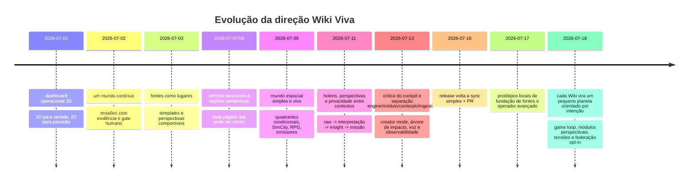
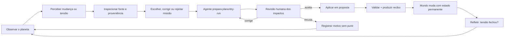
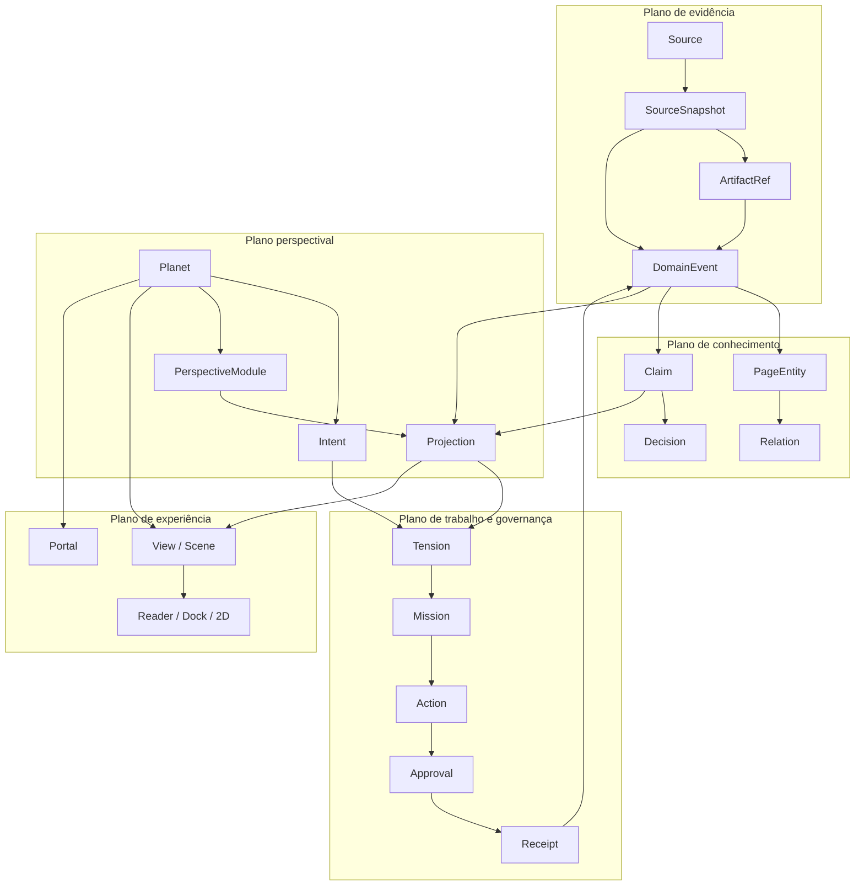
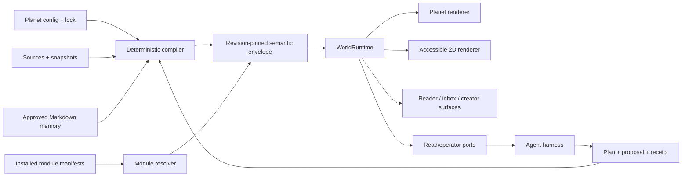
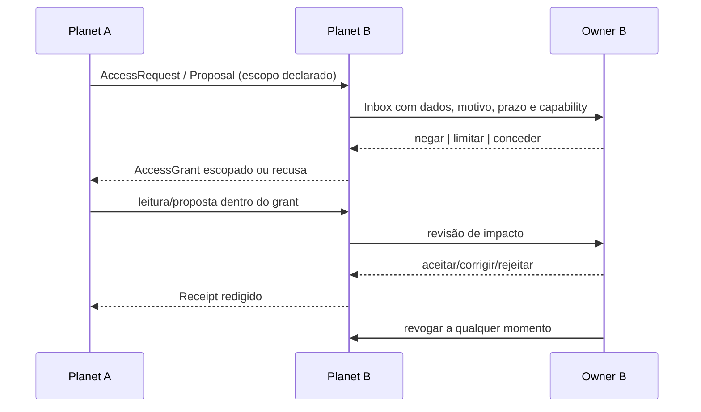
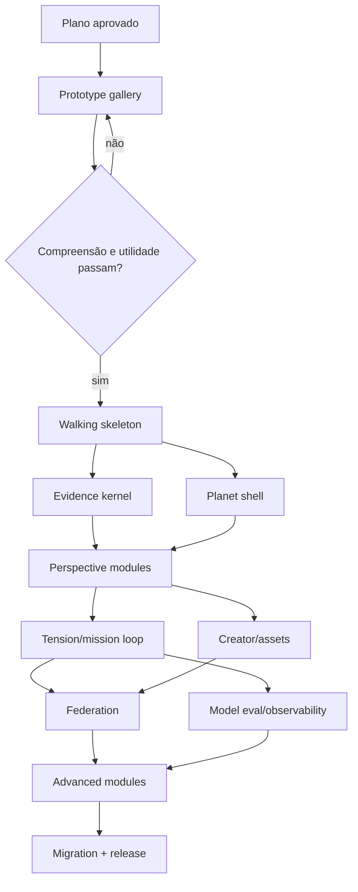

# Plano vNext — Wiki Viva Planetary Runtime

## Decisão executiva

A próxima versão da Wiki Viva deve trocar a **galáxia de itens como unidade
principal** por um **pequeno planeta vivo como unidade de experiência**. Cada
planeta representa uma Wiki orientada por uma intenção: uma pessoa, grupo,
projeto ou organização mantém sua autonomia, recebe fontes, aplica perspectivas,
percebe tensões, escolhe missões e vê seu mundo mudar com ações verificáveis.

Isso não autoriza um rewrite imediato. A ordem obrigatória é:

```text
cronologia e pesquisa
  -> protótipos visuais e de interação sem migração de dados
    -> teste de compreensão com pessoas técnicas e não técnicas
      -> decisão de produto e stack
        -> walking skeleton com contratos mínimos
          -> implementação incremental no kit público com fixtures sintéticos
            -> validação privada downstream
              -> release normal e adoção por PR
```

O nome de trabalho é **Planetary Runtime**. “Pequeno Príncipe” é uma referência
criativa para planetas pequenos, cuidado e responsabilidade; não é marca, nome
comercial nem autorização para reutilizar personagens, ilustrações ou assets da
obra. A fonte oficial confirma o planeta pequeno, a rosa sob responsabilidade e
as visitas a outros planetas, mas o produto deverá ter identidade própria:
[The Little Prince — The Book](https://www.lepetitprince.com/en/the-book/).

Este documento é a autoridade de planejamento para a descoberta vNext somente
depois de revisão humana. Ele não altera sozinho o release corrente, não declara
`v9`, não promove protótipos locais e não substitui CI, QA visual ou PR.

## Fronteira de verdade em 2026-07-18

Há três estados diferentes e eles não podem ser misturados:

| Estado | O que existe | Autoridade |
| --- | --- | --- |
| v8 validada | Runtime, rota canônica, páginas reais como centros, fontes, eventos, temporalidade, packs, fallback e sync simples já têm contratos e implementação acumulada. | Preservar até que um teste vNext prove uma substituição melhor. |
| Protótipos locais pós-v8 | Source Foundation Plane e entrada avançada de operador existem em branches/commits locais e em uma nota de v8.1 ainda não publicada. Não há branch remota nem PR correspondente na auditoria de 2026-07-18. | Hipóteses úteis; não são release nem base assumida. |
| Planetary Runtime vNext | Metáfora de planeta, game loop de tensões/missões, módulos perspectivais e federação opt-in. | Proposta deste plano; só ganha autoridade por protótipo, evidência, contratos e PRs posteriores. |

A simplificação do processo de release decidida em 2026-07-16 permanece: CI
normal do kit, gates normais do consumidor, revisão humana, tag, release notes e
seção **Upgrading**. A máquina antiga de lanes, capsules e certificações não será
reaberta. Ver o fechamento autoritativo no
[plano de release truth](wiki-viva-release-truth-temporal-world-experience-packs-plan-2026-07-11.md#2026-07-16--authoritative-closeout-simple-sync-and-private-delivery).

## Regra de consolidação cronológica

Os brainstorms são tratados como uma sequência de aprendizado, não como uma
lista plana de desejos:

1. Uma ideia posterior **supersede** uma anterior somente quando há crítica ou
   substituição explícita.
2. Quando a ideia posterior apenas detalha a anterior, o estado é **refinada**.
3. Quando a implementação já validou o contrato, ele é **preservado** até haver
   experimento que justifique mudança.
4. Ideias sem decisão, evidência ou protótipo permanecem **hipóteses**.
5. Nenhuma síntese transforma automaticamente brainstorm em claim de produto
   aprovado.

## Linha cronológica consolidada



### 2026-07-01 a 2026-07-08 — fundação espacial e operacional

As propostas iniciais estabeleceram o que continua válido:

- 3D serve a orientação, relações e descoberta; texto denso e precisão ficam em
  superfícies legíveis e em fallback 2D;
- a navegação é um mundo contínuo, sem rotas concorrentes;
- fontes são lugares/emissores e templates definem comportamento, não apenas
  campos;
- missões nascem de evidência e terminam em gate humano;
- cada página canônica pode ser centro local; quadrantes são lentes e regiões
  são agrupamentos, nunca entidades artificiais.

Fontes internas:

- [Three.js operational dashboard](threejs-operational-dashboard-plan-2026-07-01.md)
- [One-world cockpit](one-world-cockpit-plan-2026-07-02.md)
- [Codex agentic missions](codex-agentic-missions-plan-2026-07-02.md)
- [Sources, templates and facets](sources-templates-facets-plan-2026-07-03.md)
- [v8 unified living world](wiki-viva-v8-unified-living-world-execution-plan-2026-07-09.md)

**Estado:** preservado como base, mas a escala muda: “um mundo” passa a
significar um mundo contínuo **dentro de cada planeta**, não uma galáxia global
com todo item como corpo celeste.

### 2026-07-09 — simplicidade, mundo vivo e significado visual

O brainstorm de 9 de julho consolidou:

- uma cena espacial simples, navegável e visualmente memorável;
- drill-down sem categorias recursivas;
- quadrantes somente quando informam algo ou revelam uma lacuna;
- fontes como emissores de recursos;
- customização inspirada em SimCity;
- pessoas, capacidades e desenvolvimento com gramática de RPG;
- linhas, partículas e movimento somente quando codificam estado ou relação.

**Estado:** preservado. O planeta vNext absorve essas qualidades, mas remove a
obrigação de representar cada página como planeta ou objeto espacial isolado.

### 2026-07-11 — holons, perspectivas e bordas

O brainstorm de 11 de julho adicionou:

- Wiki/planeta como holon: todo autônomo e parte de sistemas maiores;
- dados brutos separados das interpretações;
- perspectivas que transformam fonte em informação, insight e missão;
- contextos privados, públicos e organizacionais com bordas explícitas;
- agentes e ferramentas associados a papéis e capacidades;
- jornada progressiva de autoconhecimento, intenção e ação.

**Estado:** refinado. Holon não será um tipo genérico aplicado a tudo sem teste.
Ele fornece três invariantes verificáveis: identidade própria, composição e
fronteira de autoridade. A origem do termo é Arthur Koestler; Wilber o usa para
todos/partes e perspectivas integrais. Referências:
[The Ghost in the Machine — registro bibliográfico](https://openlibrary.org/show-records/ia%3Aghostinmachine0000koes_w6k4) e
[Ken Wilber — Holons](https://integrallife.com/holons-turtles-all-way-turtles-all-way-down/).

### 2026-07-13 — crítica do cockpit e arquitetura modular

O brainstorm de 13 de julho registrou uma tensão concreta: timeline, radar,
agrupamentos e centro contextual já tinham muitos recursos, mas a experiência
continuava complexa e difícil de explicar. As novas propostas foram:

- separar engine visual, módulos, conteúdo e ingestão;
- compor de baixo para cima com primitivas menores;
- creator/god mode para autoria, sem misturar autoria com autoridade;
- cada Wiki como holon com privacidade própria;
- árvore editável de impactos antes da integração;
- linguagem leiga no lugar de Git;
- voz, temporalidade e observabilidade como capacidades opcionais;
- workshops, trilhas, curso e livro como hipóteses posteriores à validação.

**Estado:** preservado como diagnóstico e restrição. Voz, curso, livro e
monetização permanecem fora do MVP. O plano versionável solicitado naquele
brainstorm é este documento.

### 2026-07-16 — simplificação do release

O experimento de certificação extensa foi encerrado. A entrega volta ao fluxo
legível B0 → C1 → C2 → C3 → PR do consumidor.

**Estado:** decisão aprovada e não negociável para vNext. Não será criada outra
máquina de promoção paralela.

### 2026-07-17 — fundação de fontes e operador avançado

Dois epics locais materializaram ideias úteis:

- fundação de fontes com payload tipado, bandas verticais, diagnóstico honesto,
  fallback 2D e proveniência muitos-para-muitos;
- ritual de descoberta para operador avançado, autorização server-side,
  sessão efêmera, audit log encadeado e fluxo plan → review → execute.

**Estado:** protótipo local. O vNext pode preservar os contratos de dados,
diagnóstico e segurança, mas não assume que a geografia visual ou a nota de
release v8.1 foram aprovadas.

### 2026-07-18 — o pequeno planeta e o loop vivo

O brainstorm mais recente altera a unidade principal:

- cada Wiki é um planeta pequeno que nasce de uma intenção;
- fontes alimentam o planeta e ficam visíveis como infraestrutura;
- perspectivas são módulos acopláveis que transformam evidência em percepção;
- tensões descrevem o gap entre realidade atual e potencial percebido;
- missões e ações processam tensões com agentes e gates humanos;
- mudanças locais, propostas e integrações alteram o mundo com estados visuais
  diferentes;
- planetas podem compartilhar fontes, módulos e propostas por opt-in, com
  revogação e sem escrita direta;
- interiores, exteriores, portais e módulos geográficos permitem ambientes
  simbólicos ou reais;
- uma superfície cognitiva pequena condensa grande volume de evidência;
- UI e game loop devem ser prototipados antes de mudar schemas;
- modelos devem ser escolhidos por benchmark de qualidade, custo e latência;
- a governança deve entrar no game loop sem impor sua terminologia ao usuário.

**Estado:** nova direção proposta. Ela supersede a galáxia global como unidade
primária, mas preserva runtime, proveniência, temporalidade, fontes, packs,
acessibilidade, segurança e gate humano.

## Resolução explícita dos conflitos

| Tensão entre ideias | Resolução vNext | Teste que impede regressão |
| --- | --- | --- |
| “Um mundo” vs. “muitos planetas” | Um mundo contínuo por planeta; portais conectam planetas autônomos. Não há uma cena global que mistura todo conteúdo. | Voltar, deep link, fallback e portal preservam `planet_id`, centro e perspectiva. |
| Página real como centro vs. planeta como centro | `Planet` é o boundary de uma Wiki; dentro dele, `PageEntity` continua sendo o centro navegável real. | Nenhuma região, lente, missão visual ou módulo vira centro fictício. |
| Quadrantes nucleares vs. perspectivas acopláveis | AQAL continua disponível como módulo de perspectiva recomendado, não como decoração obrigatória em toda tela. | Instalar/remover a visualização não altera fatos, IDs ou proveniência. |
| Fonte no Git vs. fonte externa | O core preserva `Source`, `SourceSnapshot` e `ArtifactRef`; o payload bruto pode viver no Git, Drive ou outro store autorizado. | Toda derivação resolve uma referência, hash/revisão, tempo e política de acesso. |
| Memória canônica em Markdown vs. grafo eficiente | Markdown/Git segue como memória aprovada; evento e grafo são read models recompiláveis, nunca uma segunda verdade silenciosa. | Apagar e recompilar derivados produz o mesmo contrato a partir das fontes aprovadas. |
| Verdade da fonte vs. verdade perspectival | Fato/evidência e projeção da perspectiva são entidades diferentes. Uma perspectiva não reescreve a fonte. | UI e API exibem `derived_from`, perspectiva, versão, confiança e validade. |
| Git/PR como gate vs. linguagem leiga | A UI fala “revisar”, “aceitar”, “sincronizar” e “publicar”; o adaptador técnico mantém branch/commit/PR e recibo. | Modo leigo e modo técnico operam a mesma transição e produzem o mesmo recibo. |
| Game loop vs. produtividade manipulativa | O loop serve autonomia, competência, vínculo e reflexão; sem streak punitivo, energia artificial ou dark patterns. | Testes de UX verificam compreensão e agência, não tempo compulsivo no produto. |
| 3D imersivo vs. clareza/acessibilidade | 3D é uma representação opcional do mesmo estado semântico; 2D é primeira classe. | Todas as jornadas P0 passam com teclado, reduced motion e renderer 2D. |
| Marketplace de módulos vs. segurança | Registry versionado, namespaces, capabilities, preview, fixture, assinatura/hash e instalação por PR; sem código remoto arbitrário. | Módulo desconhecido ou com capability excessiva falha antes de mutar. |
| God mode visual vs. autoridade | Ritual/easter egg apenas descobre a superfície; servidor, sessão, capability e confirmação concedem autoridade. | Digitar o ritual sem sessão nunca habilita comando. |
| Automação agentic vs. determinismo | Parser, normalização, validação e transformação determinística vêm primeiro; LLM entra onde contexto é necessário e deixa cache/recibo. | O sistema informa claramente qual estágio foi script, modelo, humano e gate. |
| Decisão tomada vs. aprovação da ingestão | A decisão não é reaberta; revisa-se se a captura representa corretamente o que foi decidido. | Estados `decision_made` e `capture_pending_validation` são distintos. |

## North Star

> Uma pessoa abre sua Wiki e entende, sem conhecer Git ou agentes: **qual é a
> intenção deste mundo, o que mudou, de onde veio, qual tensão importa agora,
> qual missão pode aproximá-la do futuro desejado e o que precisa de sua
> decisão**.

### Promessa do produto

1. **Nascer pequeno:** uma intenção e uma fonte são suficientes para criar um
   planeta útil.
2. **Crescer com evidência:** toda construção visível tem origem, atualização e
   estado.
3. **Ver por perspectivas:** módulos interpretam, mas não adulteram a fonte.
4. **Agir com agência:** tensões viram missões; o usuário escolhe, corrige ou
   recusa.
5. **Colaborar sem perder fronteiras:** outros planetas propõem; o planeta dono
   aceita, limita ou revoga.
6. **Continuar legível:** densidade cresce por drill-down, não pela ocupação de
   toda a tela.

### Não objetivos do primeiro release

- metaverso, MMO, rede social ou economia virtual;
- simulador completo da vida ou “verdade universal”;
- curso, livro, coaching ou marketplace comercial pronto;
- voz como única entrada;
- fine-tuning obrigatório;
- mapa geográfico real como requisito do core;
- automação direta de build/deploy;
- escrita direta entre repositórios;
- armazenamento de todos os raws dentro do Git;
- substituição imediata dos contratos v8;
- uso infantil antes de revisão específica de segurança, privacidade e conteúdo.

## Base de pesquisa e o que realmente será importado

| Fonte primária | Relação com o plano | O que não será inferido |
| --- | --- | --- |
| [MDA — Hunicke, LeBlanc e Zubek](https://www.cs.northwestern.edu/~hunicke/MDA.pdf) | Projetar de aesthetics → dynamics → mechanics e testar cascatas entre experiência e código. | “Gamificação” não prova diversão nem retenção saudável. |
| [Self-Determination Theory — Ryan e Deci](https://www.selfdeterminationtheory.org/SDT/documents/2000_RyanDeci_SDT.pdf) | Autonomia, competência e vínculo como critérios de motivação e bem-estar. | Não usar pontos, streaks ou escassez como substitutos de motivação. |
| [PROV-O — W3C](https://www.w3.org/TR/prov-o/) | Núcleo mínimo `Entity`, `Activity`, `Agent`, uso, geração, derivação e responsabilidade. | O runtime não precisa adotar RDF para ser PROV-inspired. |
| [Databricks medallion architecture](https://docs.databricks.com/aws/en/lakehouse-architecture/deployment-guide/delta-lake) | Preservar raw reprocessável e promover derivados por qualidade. | Não importar um lakehouse ou stack Databricks para uma Wiki de arquivos. |
| [Temporal patterns — Martin Fowler](https://martinfowler.com/eaaDev/timeNarrative.html) | Separar tempo válido/evento de tempo de registro/ingestão. | Não escolher banco bitemporal antes do benchmark. |
| [Solid Protocol](https://solidproject.org/TR/2021/protocol-20211217), [WAC](https://solidproject.org/TR/wac) e [SAI](https://solidproject.org/TR/sai) | Identidade de recursos, controle de acesso, grants, pedidos, escopo e revogação entre agentes. | Não tornar Solid/RDF dependência obrigatória; usar como referência de contrato. |
| [Holacracy — tensions](https://www.holacracy.org/blog/holacracy-basics-understanding-tensions/) e [Constitution 5.0](https://www.holacracy.org/constitution/5-0/) | Tensão como gap presente/potencial, autoridade distribuída e processamento incremental. | Não adotar a constituição ou vocabulário inteiro. |
| [O2 — meta-acordos](https://o2.targetteal.com/v3.4-pt/meta-acordos) e [descrição de papéis](https://o2.targetteal.com/biblioteca/padroes/descricao-de-papeis) | Papel com propósito, responsabilidades e artefatos; autoridade sobre artefatos e tensões processadas pelo responsável. | Não copiar processos sem teste de linguagem e barreira de entrada. |
| [glTF registry — Khronos](https://registry.khronos.org/glTF/) | Formato aberto de entrega de assets 3D e extensões versionadas. | Asset público não significa licença compatível; todo asset exige manifesto. |
| [Three.js WebGPURenderer](https://threejs.org/docs/pages/WebGPURenderer.html) | Spike WebGPU com fallback WebGL 2, sem trocar stack por entusiasmo. | WebGPU não é gate de compatibilidade do MVP. |
| [WCAG 2.2 — W3C](https://www.w3.org/TR/WCAG22/) | Nomes, papéis, estados, foco, teclado, mensagens e alternativa equivalente. | Conformidade não pode ser declarada só com testes unitários. |
| [OpenTelemetry](https://opentelemetry.io/docs/) | Vocabulário vendor-neutral para traces, métricas e logs de ingestão, agentes e render. | Nenhum conteúdo privado entra em telemetria pública. |

## Contrato de produto

### Invariantes

- Um planeta tem uma intenção explícita, um owner/boundary e uma política de
  visibilidade.
- Fonte, fato, interpretação, tensão, missão, ação e recibo são estados
  distinguíveis.
- Toda representação visual resolve para dados tipados ou estado explicitamente
  sintético de demo.
- Toda projeção informa perspectiva e proveniência.
- Nenhum agente ganha mais autoridade do que a capability e o gate concedidos.
- Nenhum planeta escreve diretamente em outro.
- Remover módulo não apaga conteúdo do usuário.
- O core compila derivados; não chama um LLM embutido.
- 3D e 2D leem o mesmo estado semântico.
- Privacidade e secrets falham fechados.
- `main` continua sendo memória aprovada; propostas vivem em branch/PR.

### Vocabulário leigo e técnico

| Linguagem da experiência | Estado técnico | Significado |
| --- | --- | --- |
| Rascunho local | working tree / ephemeral state | Mudança ainda só neste dispositivo ou sessão. |
| Preparando | deterministic + contextual pipeline | Fonte em processamento, sem aprovação implícita. |
| Para revisar | proposal / diff ready | Impactos e evidências estão prontos para decisão. |
| Aceito no planeta | consolidated proposal | Conteúdo integrado na proposta, ainda sujeito ao gate configurado. |
| Publicado/sincronizado | merged approved revision | Estado aprovado no repositório correspondente. |
| Precisa de você | waiting human | Julgamento humano intencional. |
| Bloqueado | capability/dependency failure | Falta de acesso, dado, contrato ou dependência. |
| Desatualizado | stale source/projection | Frescor expirou; não significa dado falso. |

O modo técnico pode mostrar branch, SHA, diff e PR. O modo leigo nunca fabrica
sucesso e sempre permite chegar ao recibo técnico.

## Game Design Document

### Fantasia e papel do jogador

O jogador é **guardião e jardineiro de um pequeno mundo de conhecimento e
ação**. Ele não conquista outros mundos; cuida da intenção do seu, recebe
sinais, interpreta tensões, escolhe missões, constrói capacidades e cria
relações consentidas.

Papéis de interação:

| Papel | Pode | Não pode |
| --- | --- | --- |
| Owner/guardião | Definir intenção, instalar módulo, conceder acesso, aceitar proposta e publicar. | Burlar políticas de secrets ou auditoria. |
| Colaborador | Ler e propor dentro das capabilities concedidas. | Aumentar o próprio escopo ou publicar sem gate. |
| Visitante | Navegar projeções compartilhadas e solicitar acesso. | Ler raw, contexto privado ou histórico não concedido. |
| Agente | Observar inputs permitidos, planejar, executar scripts/skills autorizados e produzir proposta/recibo. | Decidir por uma pessoa, escalar capability ou escrever em outro planeta. |
| Sistema | Detectar mudanças, compilar, validar, agendar e sinalizar falhas. | Inferir consentimento ou transformar pipeline em aprovação. |

### Aesthetics desejadas

Aplicando MDA, a experiência busca:

- **descoberta:** perceber relações e mudanças antes invisíveis;
- **expressão:** o planeta reflete intenção, estilo e módulos do owner;
- **stewardship:** cuidar de fontes, compromissos, pessoas e artefatos;
- **narrativa:** ver como evidências e decisões fizeram o mundo mudar;
- **fellowship:** conectar mundos preservando autonomia e reciprocidade;
- **competência:** compreender o sistema e agir com feedback verificável;
- **serenidade operacional:** reduzir carga cognitiva, não criar mais uma fila
  infinita.

Competição, ranking social, loot boxes, streak punitivo e retenção compulsiva
não são aesthetics do produto.

### Loop principal



### Loop idle

```text
fonte muda
  -> watcher/scheduler registra tentativa
    -> extração determinística
      -> leitura contextual quando necessária
        -> perspectiva recompila projeções
          -> tensão/missão candidata aparece no inbox
            -> sistema espera decisão humana quando exigida
```

Idle significa processamento assíncrono observável, não ação invisível. O
planeta pode animar o que está acontecendo, mas a animação nunca é a única
evidência.

### Estados visuais com semântica

| Estado operacional | Metáfora visual candidata | Fallback textual obrigatório |
| --- | --- | --- |
| Mudança local/efêmera | andaime, fantasma ou partícula transitória | “Rascunho local”. |
| Proposta pronta | construção translúcida com contorno de impacto | Lista de páginas, claims, ações e riscos. |
| Integrada na branch | construção sólida ainda marcada para revisão | Estado da proposta e gates pendentes. |
| Aprovada/publicada | estrutura estável com recibo acessível | SHA/revisão, data e owner. |
| Fonte sincronizando | fluxo visível da fundação para a superfície | estágio, tempo e cancelamento. |
| Fonte stale | desgaste/clima sutil, sem alarme falso | última atualização e próxima ação. |
| Bloqueio | fluxo interrompido no ponto real da dependência | motivo seguro e capability ausente. |
| Tensão aberta | pulso localizado entre realidade e potencial | descrição, owner e próximo passo. |
| Tensão fechada | pulso resolve e registra o que mudou | ação/decisão/recibo relacionado. |

### Progressão

Progressão é capacidade e clareza, não nível social:

1. intenção registrada;
2. primeira fonte confiável;
3. primeira perspectiva instalada;
4. primeira tensão processada;
5. primeira missão concluída com recibo;
6. primeiro módulo criado ou adaptado;
7. primeiro portal consentido;
8. primeiro ciclo temporal revisto.

Cada marco deve poder ser desfeito ou reconfigurado sem perder a trilha.

### Orçamento cognitivo inicial

O protótipo começa com limites de experiência, a validar em teste:

- uma intenção visível;
- uma tensão em foco;
- até três próximas missões na superfície principal;
- um pedido primário de decisão por vez;
- mudanças periféricas agregadas por fonte/módulo;
- detalhe, histórico, riscos e alternativas por drill-down;
- nenhum número oculto quando uma lista for truncada.

Esses limites são hipótese de teste, não schema fixo.

## Modelo conceitual

### Camadas



### Primitivas e invariantes

| Primitiva | Responsabilidade mínima | Invariante |
| --- | --- | --- |
| `Planet` | Boundary de identidade, intenção, owner, política, módulos e namespace de uma Wiki. | Não contém autoridade implícita sobre outro planeta. |
| `Intent` | Futuro desejado, critérios, horizonte e histórico de revisões. | Versões anteriores permanecem rastreáveis. |
| `Source` | Identidade e lifecycle de uma origem viva. | Não é evento nem catálogo. |
| `SourceSnapshot` | Estado observado de uma fonte em uma tentativa. | Imutável, endereçável e ligado a tempo de observação. |
| `ArtifactRef` | Referência a raw/artefato local ou remoto com hash, revisão e política. | Link sem verificação não basta para derivação. |
| `DomainEvent` | Algo que aconteceu ou foi registrado, com tempos e sujeitos. | Evento e tempo de registro não são colapsados. |
| `PageEntity` | Página Markdown canônica aprovada ou proposta. | ID estável; paths e títulos podem mudar. |
| `Claim` | Afirmação com status epistêmico, evidência, validade e perspectiva quando derivada. | Claim não vira fato por repetição. |
| `Relation` | Vínculo tipado, direcional e proveniente. | Linha visual sem tipo não entra no contrato. |
| `PerspectiveModule` | Transformação versionada de evidência em projeção, view e possíveis tensões. | Não altera raw nem enfraquece política. |
| `Projection` | Resultado recompilável de uma perspectiva sobre um escopo. | Sempre declara módulo/versão/input e `derived_from`. |
| `Tension` | Percepção do gap entre realidade atual e potencial. | Não é automaticamente problema, tarefa ou decisão. |
| `Mission` | Opção estruturada para processar uma tensão. | Explica por que existe, impacto, owner e gate. |
| `Action` | Trabalho canônico com estado e evidência. | `done` exige recibo ou razão revisada. |
| `Decision` | Escolha tomada com autoridade, contexto e efeitos. | Captura pendente de validação não reabre a escolha. |
| `CapabilityGrant` | Permissão escopada por ator, recurso, ação, tempo e contexto. | Default deny, expiração e revogação. |
| `Approval` | Julgamento humano exigido por política. | Não pode ser inferido de clique ambíguo ou ausência de resposta. |
| `Receipt` | Resultado tipado, revisionado, redigido e idempotente de uma operação. | Sucesso visual sem recibo é inválido. |
| `Portal` | Navegação/solicitação entre planets e projeções. | Portal não concede acesso. |
| `ModuleManifest` | Contribuições, dependências, capabilities, fixtures, migrações e fallback. | Sem execução remota arbitrária. |

### Núcleo de proveniência

O modelo mínimo será inspirado em PROV-O, sem obrigar RDF:

```yaml
entity:
  id: artifact-or-page-id
  revision: content-hash-or-git-sha
activity:
  id: ingest-or-transform-attempt
  used: [entity-id]
  generated: [entity-id]
agent:
  kind: human | software_agent | system | organization
  ref: stable-ref
association:
  activity: activity-id
  agent: agent-ref
  role: parser | contextual_reader | reviewer | publisher
```

O contrato precisa responder: o que foi usado, o que foi gerado, por qual
atividade, por qual agente/papel e sob qual revisão.

### Tempo

Preservar e ampliar o kernel temporal existente:

| Campo | Pergunta |
| --- | --- |
| `occurred_at` / `valid_from` | Quando aconteceu ou passou a ser válido no mundo modelado? |
| `recorded_at` | Quando a Wiki soube? |
| `ingested_at` | Quando entrou no pipeline? |
| `observed_at` | Quando a fonte externa foi lida? |
| `verified_at` | Quando a evidência foi checada? |
| `superseded_at` | Quando deixou de ser a interpretação corrente? |

Nenhum “world replay” será inventado entre pontos sem evidência. O usuário deve
poder alternar tempo do evento e tempo do registro e enxergar precisão ausente.

### Raw, compilado e aprovado

```text
RAW / bronze
  fonte ou ArtifactRef reprocessável
    -> NORMALIZED / silver
       eventos, entidades e relações validadas
         -> PERSPECTIVE / projection
            leitura versionada por módulo
              -> PROPOSAL
                 diff conceitual + impactos + riscos
                   -> APPROVED MEMORY
                      Markdown/Git em main + recibo
```

O naming bronze/silver é apenas uma analogia. Os nomes públicos do produto
serão “origem”, “estrutura”, “perspectiva”, “proposta” e “memória aprovada”.

## Arquitetura alvo

### Microkernel

O v8 já tem `WorldRuntime`, reducer, registries ativos e descritores ainda não
ativáveis. O vNext não criará um segundo plugin system. Ele evolui o kernel
existente em etapas:



Núcleo estável:

- identidade de planeta e entidades;
- rota/estado semântico;
- source/event/provenance lifecycle;
- policy/capability/receipt;
- module resolver e compatibility checks;
- snapshot/envelope atômico;
- 2D/3D parity contract;
- human/PR gate.

Contribuições de módulo:

- page types, templates e blocks;
- perspective processors;
- views, overlays, scenes e surfaces;
- tensions/mission generators;
- source adapters e schedulers;
- commands declarativos e ports autorizados;
- temporal profiles;
- policies e visibility defaults;
- assets com licença/hash;
- fixtures, demos, i18n, testes e migrações.

### Contrato de módulo v0 para protótipo

O schema só será congelado depois do prototype gate, mas o protótipo deve testar
este formato conceitual:

```yaml
schema_version: wiki_planet_module.v0
id: study-path
version: 0.1.0
compatible_core: ">=8 <10"
kind: perspective | mission | source | scene | governance | composite
intent_fit:
  - learning
inputs:
  entity_types: [source, note, claim]
outputs:
  projections: [learning-map]
  tension_kinds: [knowledge-gap]
  mission_kinds: [study-checkpoint]
capabilities:
  required: [read_selected_sources]
  optional: [schedule_refresh]
privacy:
  default_visibility: private
  export_policy: synthetic_only
runtime:
  deterministic_entrypoints: []
  contextual_prompt_refs: []
  views: []
  surfaces: []
fallback:
  two_d: required
assets:
  manifest: assets/manifest.yaml
fixtures: [minimal, normal, dense, failure, privacy]
migrations: []
```

Instalação continua reviewable:

```text
descobrir -> inspecionar -> preview sintético -> capabilities -> dry-run
          -> branch/PR -> validar -> ativar -> atualizar/desabilitar/remover
```

### Armazenamento e crescimento

- Raw grande vive fora do Git por padrão, com `ArtifactRef`, hash, tamanho,
  owner, localização e regra de retenção.
- Markdown aprovado e pequenos contratos continuam no Git.
- Read models, embeddings, transcrições e snapshots são regeneráveis e podem
  viver em stores derivados.
- Assets usam content hash, glTF quando 3D e manifesto de licença.
- Logs são bounded, redigidos e rotacionados; diagnósticos não guardam prompts
  completos ou conteúdo privado por padrão.
- Cada payload declara total, retornado, truncamento e cursor.
- Atualização incremental trabalha por source snapshot/event/module; não
  recompila o mundo inteiro sem necessidade.

## Privacidade, federação e autoridade

### Princípio

**Conexão não implica visibilidade; visibilidade não implica autoridade; e
autoridade não implica publicação.**

### Fluxo entre planetas



### Requisitos

- default deny;
- grants por ator/aplicação, recurso, ação, propósito, contexto e tempo;
- expiração e revogação propagadas;
- dados compartilhados por projection/view quando raw não é necessário;
- segmentação de uma mesma fonte por visibilidade;
- políticas herdadas nunca ampliam acesso silenciosamente;
- auditoria informa quem viu/propôs/alterou sem vazar o conteúdo;
- public export revalida cada entidade, relação e asset;
- crianças recebem políticas próprias e não podem ser um “perfil” configurável
  sem avaliação de produto e compliance;
- federação vem depois de o planeta isolado provar valor.

## Agentes, modelos e custo

### Fronteira determinística/contextual

| Trabalho | Padrão |
| --- | --- |
| Hash, parsing, chunking, schema, link, data, diff, policy, capability, migration | Determinístico. |
| Classificação com regra suficiente | Determinístico e explainable. |
| Síntese, relação contextual, ambiguidade, proposta de missão | LLM com prompt versionado, contexto mínimo e cache. |
| Decisão pessoal, aprovação, permissão, publicação | Humano/política; modelo apenas recomenda. |
| Comando operacional | Port allowlisted, preview, idempotency key e receipt. |

### Benchmark por módulo

Cada módulo contextual declara:

- dataset sintético público e casos privados somente no consumidor;
- output schema e rubric;
- gold set revisado por humano/modelo forte;
- precisão de fatos e citações;
- completude de impactos;
- taxa de falso positivo em tensões/missões;
- leak/privacy score;
- latência, tokens e custo;
- modelo/prompt/version/hash;
- regra de fallback e abstention.

Seleção:

1. modelo forte estabelece baseline e falhas;
2. prompt, exemplos e contexto são otimizados;
3. modelos menores competem no mesmo benchmark;
4. o menor modelo que passa o threshold do módulo vira recomendação;
5. regressão reabre a seleção;
6. fine-tuning só entra quando houver corpus revisado, contrato estável e ganho
   mensurável sobre prompt/examples.

Nenhum módulo depende de um fornecedor chamado no brainstorm. O contrato é de
capacidade, não de marca.

### Observabilidade

Traces ligam:

```text
source_attempt -> extraction -> contextual_pass -> projection
               -> tension/mission proposal -> operator attempt -> receipt
```

Métricas mínimas: duração, cache hit, tokens, custo estimado, modelo, erros,
abstenções, tamanho de input/output, objetos afetados e gate. Conteúdo e secrets
não entram em telemetria.

## Sistema visual e spike de tecnologia

### Decisão adiada conscientemente

Web + React + Three.js é a hipótese líder porque já existe runtime e alcance de
browser. Não é uma decisão fechada para todo módulo. O spike compara:

| Opção | Testar | Critério |
| --- | --- | --- |
| Three.js WebGL atual | Reuso, estabilidade, bundle e mobile. | Baseline. |
| `WebGPURenderer` com fallback WebGL 2 | Qualidade, efeitos e custo de migração. | Não reduzir compatibilidade. |
| Voxel/chunk renderer | Construção modular, interiores e streaming. | Só avança se simplificar autoria/runtime. |
| 2D/isométrico | Clareza, acessibilidade e baixo custo. | Deve operar todo o P0, mesmo que 3D vença. |
| Híbrido 3D + surfaces 2D | Imersão com leitura precisa. | Hipótese preferencial a validar. |

### Assets

- glTF 2.0 como formato preferencial de entrega 3D;
- manifesto com URL/origem, autor, licença, versão, hash, tamanho, polígonos,
  texturas, LOD e uso permitido;
- catálogo curado por estilo; marketplace geral não entra no core;
- instancing, lazy load, LOD e limites de memória;
- nenhum asset externo executa código;
- nenhuma referência do Pequeno Príncipe é copiada sem licença;
- efeitos e transições próprios só quando codificam estado.

### Budgets preservados do v8

Até o spike provar mudança, permanecem os budgets de
[runtime v8](../guides/wiki-viva-v8-runtime-architecture.md#performance-and-bundle-budgets):

- 250 nós interativos em desktop normal / 120 em mobile;
- 600 relações visíveis desktop / 220 mobile;
- 80 labels desktop / 35 mobile;
- mínimo 30 FPS desktop / 24 FPS mobile;
- mundo utilizável em até 3 s desktop / 4 s mobile;
- efeitos degradam antes de semântica;
- bundles acima do orçamento bloqueiam.

## Protótipos de experiência antes do schema

### Jornada A — nascimento

```text
┌──────────────────────────────────────────────────────────────┐
│ O que este pequeno mundo quer tornar possível?              │
│ [ intenção em linguagem natural                         ]    │
│                                                              │
│ Começar com:  (•) uma pasta  ( ) uma conversa  ( ) vazio   │
│                                                              │
│ O planeta usará inicialmente:                                │
│ ✓ fontes privadas  ✓ revisão humana  ✓ histórico técnico    │
│                                              [Nascer mundo]   │
└──────────────────────────────────────────────────────────────┘
```

Gate: pessoa não técnica explica intenção, fonte, privacidade e próximo passo
sem ajuda do facilitador.

### Jornada B — planeta em operação

```text
┌──────────────────────────────────────────────────────────────┐
│ Intenção: aprender IA aplicando em projetos reais            │
│ Mudou desde ontem: 3 fontes • 1 perspectiva • 1 tensão      │
│                                                              │
│                 [ pequeno planeta / 2D map ]                  │
│        fontes ── conhecimento ── relações ── missões          │
│                                                              │
│ Tensão em foco                                               │
│ “há muita leitura e pouco experimento aplicado”              │
│ [ver evidência]  [aceitar missão]  [corrigir]  [ignorar]     │
│                                                              │
│ Próximas missões (3)                      [abrir inbox: 8]    │
└──────────────────────────────────────────────────────────────┘
```

Gate: a tensão é compreendida como hipótese ligada a evidência, não como ordem.

### Jornada C — revisão de impacto

```text
┌──────────────────────────────────────────────────────────────┐
│ Para revisar: “criar trilha de estudo aplicada”              │
│                                                              │
│ Fonte ─> projeção ─> tensão ─> missão ─> páginas/ações        │
│                                                              │
│ + 1 missão    + 3 ações    ~ 2 claims    0 exclusões          │
│ Riscos: prazo inferido • uma relação com baixa confiança     │
│                                                              │
│ [remover item] [editar] [pedir nova análise]                 │
│                         [aceitar na proposta]                 │
└──────────────────────────────────────────────────────────────┘
```

Gate: usuário consegue remover um impacto, corrigir uma relação e entender que
aceitar na proposta ainda não significa publicar.

### Jornada D — módulo

```text
┌──────────────────────────────────────────────────────────────┐
│ Módulo: CRM de relações                                      │
│ Lê: reuniões e contatos selecionados                         │
│ Produz: pessoas, cadência, compromissos e próximas conversas │
│ Pede: read_selected_sources • schedule_refresh (opcional)    │
│ Não pode: publicar • compartilhar raw • escrever fora        │
│ Preview: [minimal] [normal] [falha] [privacidade]             │
│                                [dry-run de instalação]        │
└──────────────────────────────────────────────────────────────┘
```

Gate: capabilities são compreendidas antes da instalação.

### Jornada E — portal

```text
┌──────────────────────────────────────────────────────────────┐
│ Outro planeta oferece uma trilha de IA                       │
│ Compartilhará: projeção pública + 4 fontes citáveis          │
│ Solicita: sua intenção de aprendizagem (somente leitura)     │
│ Duração: 30 dias • revogável • raw não incluído              │
│                                                              │
│ [negar] [pedir menos acesso] [conceder por 30 dias]          │
└──────────────────────────────────────────────────────────────┘
```

Gate: portal sem grant mostra somente convite/preview seguro.

## Integração das duas epics locais

### Source Foundation Plane

Preservar como candidato:

- payload `wiki_web_source_foundation.v1` e capability honesta;
- many-to-many source → page;
- lifecycle/freshness/attempt em uma única verdade;
- diagnóstico de payload ausente/malformado;
- renderer isolado e fallback equivalente.

Reabrir no protótipo:

- se a fundação é hemisfério inferior, interior do planeta, infraestrutura
  subterrânea, edifício ou surface 2D;
- como transições comunicam fonte sem esconder texto;
- se “bandas” continuam compreensíveis depois da metáfora planetária.

### Operador avançado

Preservar como candidato:

- sessão local efêmera e server-authorized;
- startup challenge, TTL/idle expiry e nenhum token persistido no browser;
- audit log tamper-evident;
- plan → review → execute com `plan_sha`;
- browser nunca envia `argv`.

Reabrir:

- ritual e personagem são easter egg opcional, não parte do onboarding P0;
- “creator mode” e “admin mode” devem ter capabilities distintas;
- autoria de módulo não significa autoridade operacional.

## Programa de execução

### Gate P0 — aprovação deste plano

Entregas:

- revisão cronológica e dos conflitos;
- confirmação de `vNext` sem número;
- autorização para prototype gallery;
- decisão sobre onde vive a branch focada.

Não entrega código de runtime.

### Fase 1 — prototype gallery, sem alterar schemas

PR 1 — `wiki/planetary-prototype-gallery`

- storyboard e wireframes das cinco jornadas;
- 3 direções visuais geradas/desenhadas: 3D, 2D/isométrica e híbrida;
- protótipo clicável com dados totalmente sintéticos;
- copy PT-BR e EN;
- reduced motion, teclado e mobile desde o protótipo;
- teste de compreensão gravado por roteiro, sem dado pessoal no kit.

Aceite:

- pelo menos três pessoas não técnicas e duas técnicas completam nascimento,
  inspeção de fonte, revisão e recusa;
- 4/5 explicam corretamente planeta, fonte, tensão, missão e publicação;
- nenhuma confunde efeito visual com aprovação;
- 2D completa as mesmas tarefas P0.

Rollback: remover a gallery não toca runtime nem schema.

### Fase 2 — decisão de produto e walking skeleton

PR 2 — ADRs e contratos mínimos:

- decisão de stack visual;
- decisão de naming público;
- `Planet`, `Intent`, `Projection`, `Tension` e `ModuleManifest` v1 somente com
  campos exercitados pelo protótipo;
- aliases/migrators para v8;
- fixture `empty_birth`, `one_source`, `one_tension`, `review`, `failure`;
- 2D/3D parity test.

Aceite: uma jornada completa funciona com uma fonte sintética e uma missão,
sem migrar o catálogo inteiro.

### Fase 3 — evidence kernel

PR 3:

- `SourceSnapshot`, `ArtifactRef`, proveniência PROV-inspired;
- `occurred_at` vs. `recorded_at`/`ingested_at`;
- raw externo e raw versionado no mesmo contrato;
- incremental compiler e invalidação por source/module revision;
- estados honestos de fonte e truncamento.

Aceite: apagar derivados e recompilar reproduz o envelope; modificar uma fonte
não recompila módulos não afetados.

### Fase 4 — planetary runtime shell

PR 4:

- `planet_id` no envelope e rota;
- planet overview sem quebrar PageEntity centers;
- nascimento e empty state;
- renderer selecionado + 2D equivalente;
- sem portal/federação ainda;
- telemetry e budgets.

Aceite: refresh, deep link, Back, mobile, keyboard, WebGL loss e fallback
preservam estado semântico.

### Fase 5 — module/perspective kernel

PR 5:

- resolver único a partir de experience packs existentes;
- manifest, dependency/conflict, namespaces, capabilities e lock;
- install/disable/remove por dry-run e PR;
- perspective projection versionada;
- módulo AQAL/quadrantes como primeiro compatibility module;
- Study/Research como conformance module.

Aceite: instalar/remover perspectiva não altera raw nem apaga conteúdo; ordem de
módulos não muda semântica silenciosamente.

### Fase 6 — tensions, missions e governance loop

PR 6:

- `Tension`, `Mission`, `DecisionCapture`, `Approval`, `Receipt`;
- distinção tensão/problema/tarefa;
- next-best-action explicável e recusável;
- inbox e árvore de impacto editável;
- decisão tomada vs. captura pendente de validação;
- visual states permanentes/temporários.

Aceite: uma tensão pode fechar por informação, ação ou decisão; recusar missão
não pune nem reapresenta infinitamente.

### Fase 7 — creator mode e catálogo de assets

PR 7:

- creator capabilities separadas de admin/operator;
- composer de módulo com preview sintético;
- manifest glTF/licença/hash/LOD;
- catalog curated e fallback;
- nenhuma instalação de código remoto arbitrário.

Aceite: módulo inválido, asset sem licença ou capability excessiva falha antes
da mutação.

### Fase 8 — federação opt-in

PR 8:

- `AccessRequest`, `AccessGrant`, `AccessReceipt`, revogação e expiração;
- portal seguro e preview público;
- proposta cross-planet, nunca write-through;
- visibility slices e teste de reunião com trechos públicos/privados;
- export boundary.

Aceite: suíte adversarial prova default deny, revogação, ausência de raw e zero
escalation.

### Fase 9 — model evaluation e observabilidade

PR 9:

- benchmark runner/provider-neutral;
- gold sets sintéticos, rubrics e abstention;
- recomendação por módulo;
- custo/latência/cache no receipt;
- OTel-compatible trace vocabulary;
- privacy-safe telemetry.

Aceite: ao menos dois perfis de modelo são comparados no mesmo contrato e a
seleção pode cair para um modelo menor sem perder o threshold.

### Fase 10 — módulos avançados

Depois do core:

- CRM de relações;
- Team OS com papéis/tensões/artefatos;
- módulo geográfico sintético;
- interiores/voxel se o spike tiver vencido;
- voz como input opcional;
- integração de engenharia somente em dry-run/proposal mode.

Cada módulo é PR próprio e pode ser rejeitado sem bloquear o release planetário.

### Fase 11 — migração e release

- migrator v8 → vNext reversível;
- compatibility window documentada;
- tag/release notes/Upgrading;
- B0 → C1 → C2 → C3 no consumidor;
- PR privado com gates e readback visual;
- piloto privado pessoal primeiro;
- piloto geográfico/organizacional somente depois, com fonte e política próprias.

## Grafo de dependências



## Matriz de experimentos

| Hipótese | Experimento | Métrica/threshold proposto | Decisão |
| --- | --- | --- | --- |
| Planeta comunica melhor que galáxia | Comparação de storyboard e tarefas. | ≥80% descrevem intenção, fonte e próxima ação sem jargão. | Manter planeta ou revisar metáfora. |
| Idle loop aumenta clareza | Simular fonte atualizando e inbox. | Usuário sabe o que aconteceu, o que espera decisão e o que não foi publicado. | Aprovar ou reduzir animação. |
| Uma tensão em foco reduz carga | Comparar lista extensa vs. foco + drill-down. | Menos erro de escolha e igual acesso ao histórico. | Fixar orçamento inicial ou recalibrar. |
| 3D acrescenta sensemaking | Mesmas tarefas 3D e 2D. | 3D melhora orientação sem piorar conclusão, mobile ou acessibilidade. | Manter híbrido, 2D-first ou abandonar 3D P0. |
| Módulo é compreensível antes de instalar | Tela de capabilities + preview. | Usuário prediz corretamente inputs, outputs e riscos. | Congelar/ajustar manifest. |
| Tensão gera ação útil | Fixture com tensão real, falsa e resolvida por informação. | Baixo falso positivo e possibilidade de abstention/recusa. | Liberar gerador ou manter manual. |
| Modelo menor é suficiente | Benchmark contra gold strong-model/human-reviewed. | Passa qualidade/privacy com custo ou latência materialmente menor. | Recomendar por módulo. |
| Portal preserva autonomia | Teste adversarial de grant/revoke. | Zero leitura/escrita fora de escopo; revogação efetiva. | Autorizar federação ou bloquear. |

Thresholds são propostas a confirmar no Gate P0. Resultados e amostra devem ser
registrados; “pareceu melhor” não fecha experimento.

## Gates de qualidade

### Contratos e dados

- schema/version/compatibility;
- proveniência completa;
- bitemporalidade e precisão ausente;
- recompilação determinística;
- incremental invalidation;
- truncamento explícito;
- no sample fallback fora de demo;
- source lifecycle coerente;
- secret scan e public-export scan.

### Produto e visual

- nascimento, primeira fonte, primeira tensão, revisão, recusa e receipt;
- desktop, mobile, 2D, keyboard e reduced motion;
- Back/deep link/refresh;
- leitura direta de todos os estados;
- FPS, bundle, memória e load budgets;
- screenshots e gravação de jornadas, não somente testes verdes;
- teste com pessoas não técnicas.

### Segurança

- default deny;
- capability matrix;
- Host/Origin/session/CSRF/idempotency;
- plan hash e command allowlist;
- grant/revoke/expiry;
- visibility slicing;
- nenhum secret ou conteúdo privado em log/telemetria;
- fuzz/adversarial de manifest, route e payload.

### Release

Fluxo normal do kit:

```sh
python3 scripts/wiki_audit.py --check
python3 scripts/wiki_audit.py --public-export --check
python3 scripts/wiki_check_methodology_coverage.py --check
python3 scripts/wiki_operation_compile.py --check
python3 scripts/wiki_input_stage.py --check
python3 scripts/wiki_semantic_inventory.py --check
python3 scripts/wiki_web_snapshot.py --check-contract
python3 scripts/wiki_pack.py validate --all
python3 -m pytest tests/
npm --prefix apps/wiki-cockpit test
npm --prefix apps/wiki-cockpit exec -- tsc -p apps/wiki-cockpit/tsconfig.json --noEmit
npm --prefix apps/wiki-cockpit run build
```

Além disso, cada PR visual executa suas jornadas Playwright e recebe readback
humano. Release só depois de PR público, tag e Upgrading; downstream somente
por sync + PR próprio.

## Riscos e contramedidas

| Risco | Sinal precoce | Contramedida |
| --- | --- | --- |
| Outro rewrite grande | PR toca kernel, schemas e toda UI antes de prototype gate. | Bloquear; voltar à gallery e walking skeleton. |
| Metáfora domina função | Usuário lembra do planeta, mas não acha fonte/decisão. | Medir tarefas; tornar surface operacional primária. |
| Planet vira nova entidade monolítica | Toda mudança recompila/carrega tudo. | Invalidação por source/event/module e budgets. |
| Perspectiva vira verdade | Claim derivado aparece sem módulo/proveniência. | Separação de tipos e UI obrigatória. |
| Marketplace vira supply-chain risk | Código/asset remoto executado na instalação. | Manifest, hash, allowlist, fixture, PR e sem arbitrary code. |
| Federação vaza dados | Grant amplo ou slicing posterior à ingestão. | Default deny e slicing antes da projeção/compartilhamento. |
| Game loop cria ansiedade | Inbox infinita, streak ou alerta constante. | Orçamento cognitivo, quiet states, snooze/ignore e SDT. |
| 3D quebra mobile/acessibilidade | Jornadas só passam no desktop WebGL. | 2D-first parity e gate P0. |
| Modelo caro vira default | Sem benchmark por módulo. | Gold baseline, smaller-model competition e budgets. |
| Modelo barato degrada verdade | Seleção só por custo. | Threshold de fatos, proveniência, privacy e abstention. |
| Logs incham repo | Traces/transcrições versionados indiscriminadamente. | Store derivado, retenção, hash refs e manifests. |
| Governança aumenta barreira | Usuário precisa aprender Holacracia/O2. | Linguagem leiga; conceitos no motor, não no onboarding. |
| Protótipos locais viram release por narrativa | Nota v8.1 citada como entregue. | Quadro de estados e PR/remote check antes de qualquer claim. |
| Piloto privado vira upstream | Core desenhado diretamente sobre dados pessoais. | Fixture sintético público primeiro; privado só pressão downstream. |

## Decisões abertas, em ordem

1. A metáfora planetária passa no teste de compreensão?
2. Qual direção visual vence: 3D, 2D/isométrica ou híbrida?
3. Qual é o nome público, sem depender de propriedade intelectual alheia?
4. `Planet` precisa ser entidade persistida ou boundary compilado a partir da
   configuração da Wiki?
5. Quais cinco campos mínimos do `Intent` são realmente usados no protótipo?
6. O event/read model permanece arquivo/JSON ou exige store especializado após
   benchmark?
7. Experience pack será evoluído in-place ou ganhará alias compatível para
   `planet module`?
8. Quais capabilities são P0 para creator e quais são admin/operator?
9. Qual visual da Source Foundation é compreensível dentro do planeta?
10. Qual módulo é conformance depois de Study/Research: CRM ou Team OS?
11. Qual amostra e threshold fecham os testes de compreensão?
12. Qual número de versão será atribuído somente depois do walking skeleton?

As decisões 4–12 não bloqueiam a gallery; tentar resolvê-las todas antes do
protótipo repetiria o erro de supermodelar cedo demais.

## Definition of Done do vNext

O vNext está pronto quando, no mesmo subject público revisado:

- o planeta nasce de uma intenção e uma fonte sintética;
- fonte, projeção, tensão, missão, ação, aprovação e receipt são distinguíveis;
- 3D e 2D concluem as jornadas P0;
- uma pessoa não técnica entende o fluxo sem Git;
- a trilha técnica continua auditável por SHA/diff/PR;
- toda projeção resolve proveniência e tempos;
- módulo instala, desabilita, atualiza e remove sem apagar conteúdo;
- privacy/default-deny e public export passam;
- agente opera somente por capabilities e proposal gate;
- o loop não usa dark patterns;
- budgets, WCAG, mobile e reduced motion passam;
- Source Foundation e operador avançado têm disposição explícita;
- migração v8 é reversível e compatibility window está documentada;
- kit público passa CI e QA visual;
- consumidor privado passa seus gates e readback real;
- release tem tag, notes, Upgrading e sync normal;
- nenhum item é chamado de entregue apenas por estar em branch local.

## Próxima ação única

Revisar e aprovar este plano como **PR 0**. Em seguida criar somente a
`prototype gallery` da Fase 1. Nenhuma migração de schema, módulo runtime,
federação ou mudança downstream deve começar antes do teste de compreensão.

