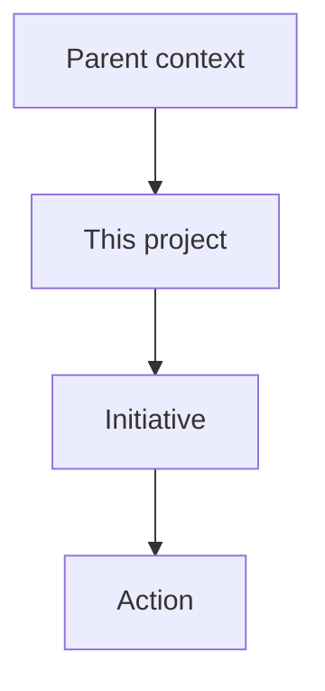

# Template - project

```yaml
---
page_id: project-example
page_type: project
title: "Project - example"
aliases:
  - Example project
tags:
  - wiki/project
  - status/active
status: active
context: system
visibility: private_self
updated_at: YYYY-MM-DD
stale_after_days: 30
sources_policy: memorias_consolidadas
gate: github_pr
sensitive_data_policy: private_sensitive_allowed
owner: {{owner_id}}
moc_parent: memories/index.md
# perspective_bundle_required: []
# perspective_bundle_optional: []
related_holons: []
roles: []
responsibilities: []
source_refs: []
claims: []
decisions: []
actions: []
evidence_refs: []
---
```

# Project - example

> Illustrate by default: show how this project sits between its context, its
> initiatives, and its actions with a Mermaid flowchart. See the representation
> conventions in [obsidian-conventions.md](obsidian-conventions.md).



## Purpose

-

## State

-

## Integral map

All quadrants are relative to this center; use declared evidence, never invent
interior experience for an organization or project.

### Q1 — Intent and identity

Test: does this describe the center's declared identity, meaning or intent?

<!-- integral-map:q1:start -->
_Empty: `quadrant_absence` mission._
<!-- integral-map:q1:end -->

### Q2 — Outputs and evidence

Test: is this an observable output, behavior or evidence of this center?

<!-- integral-map:q2:start -->
_Empty: `quadrant_absence` mission._
<!-- integral-map:q2:end -->

### Q3 — Culture and relationships

Test: does this express shared meaning, lived expectations or relationships?

<!-- integral-map:q3:start -->
_Empty: `quadrant_absence` mission._
<!-- integral-map:q3:end -->

### Q4 — Systems and governance

Test: does this coordinate the collective through systems, rules or processes?

<!-- integral-map:q4:start -->
_Empty: `quadrant_absence` mission._
<!-- integral-map:q4:end -->

## Perspective bundle

Inherited from the root: `perspective-identity-intent`,
`perspective-artifacts-evidence`, `perspective-roles-relationships` and
`perspective-systems-processes` (all required). Additional thematic perspectives
and local promotions are declared in `perspective_bundle_optional` and
`perspective_bundle_required` in this anchor's frontmatter.

## Related

- Parent MOC:
- Initiatives:
- Actions:
