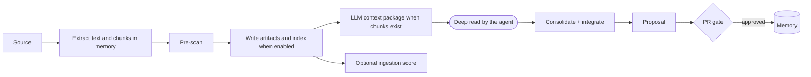

# Ingestion process

Updated on: 2026-08-28

This process turns a new source into a reviewable proposal, consolidated memory,
or a decision not to ingest.

## Automated flow (orchestrator)

The [orchestrator](../../scripts/wiki_ingest.py) extracts text and chunks in
memory, performs **pre-scan before persistence** (secret blocks; PII informs),
then writes the manifest/text/chunks and updates the index. The
[pipeline](../../wiki_core/ingest/pipeline.py) prepares the LLM request when
chunks exist without secrets, persisting it only in write mode. The
`ingestar_fonte_valida` score event requires persistence, chunks and enabled
scoring. `--dry-run` writes no artifacts, index or score; `--no-score` disables
scoring. The standalone CLIs still exist, with their own boundaries below.

The LLM pass remains delegated to the operating agent, which reads the package
and records its result. Required deep reading (`required_context_pass`) remains
a gate. Reading does not finish ingestion: the
[consolidator](../../scripts/wiki_consolidate.py) emits the event and integration
packet; `--check` detects a missing event or empty `consolidated_into`. The
[auditor](../../scripts/wiki_audit.py) separately verifies valid destinations,
source backlinks and synthesis beyond the source catalogue. Normal independent
PR review, applicable gates and privacy remain required.

To close the **Information -> Insight** cycle, [scripts/wiki_insight_job.py](../../scripts/wiki_insight_job.py)
gathers events+chunks+pages by theme and emits a PROPOSAL of an insight (candidate)
for a PR review gate — without writing canonical memory.

The orchestrated path, end to end:

The deterministic stages, the command that runs each, and what gates it:

| Stage | Command | Gate |
| --- | --- | --- |
| Standalone manifest | [wiki_extract_source_manifest.py](../../scripts/wiki_extract_source_manifest.py) | no pre-scan; do not persist ahead of secret screening |
| Text + chunks | [wiki_extract_text.py](../../scripts/wiki_extract_text.py) | secret pre-scan before writing manifest/text/chunks |
| Index | [wiki_build_index.py](../../scripts/wiki_build_index.py) | none |
| Orchestrated extraction + context package | [wiki_ingest.py](../../scripts/wiki_ingest.py) | pre-scan before persistence; request requires chunks and is written only in write mode |
| Deep read | [wiki_llm_context_pass.py](../../scripts/wiki_llm_context_pass.py) | `required_context_pass` requires a recorded result |
| Consolidate + integrate | [wiki_consolidate.py](../../scripts/wiki_consolidate.py) | new event needs `consolidated_into`; `--check` fails a read source without integration (CI) |
| Consolidation + audit | [wiki_audit.py](../../scripts/wiki_audit.py) | destinations, source backlinks, synthesis, contract/links/secrets; repository review policy on the PR |

## Flow

1. Identify the source without copying access secrets into the conversation.
2. Classify the source as `memory`, `reference`, `artifact`, `raw`, or
   `no_ingest`.
3. Define the target context among those declared in [wiki.config.yaml](../../wiki.config.yaml)
   (`contexts`); `system` is always valid.
4. Use the [orchestrator](../../scripts/wiki_ingest.py) for extraction and
   screening before persistence. In a manual flow, the
   [text extractor](../../scripts/wiki_extract_text.py) screens before writing
   the manifest, text and chunks; do not preempt it with the
   [standalone manifest command](../../scripts/wiki_extract_source_manifest.py),
   which does not screen secrets. Metadata alone does not prove reading.
5. Verify extracted text and chunks when new semantic content exists; preserve
   source identity and distinguish extraction from consolidated synthesis.
6. Record a normalized event in [memories/system/ingestion/events/](ingestion/events/README.md)
   with four quadrants or an explicit absence.
7. Plan the contextual LLM pass with [scripts/wiki_llm_context_pass.py](../../scripts/wiki_llm_context_pass.py)
   and record the cache/plan or a skip justification.
8. Consolidate and INTEGRATE with [scripts/wiki_consolidate.py](../../scripts/wiki_consolidate.py):
   `--source <source_id> --emit-event --packet`, with either `--source-page` or
   `--source-ref` identifying the canonical source, generates the normalized event
   from the recorded deep read (quadrants filled, candidate claims/decisions/
   actions, `consolidated_into: []` to close) and the integration packet
   (gitignored, with related pages, overlapping claims and potential conflicts).
   Guided by the packet: update the target hubs/concepts incrementally;
   create/update load-bearing claim pages (fields `supersedes`/`superseded_by`/
   `conflicts_with`/`conflict_resolution` when claims collide); resolve or
   record every conflict and ambiguity; fill in the event's `consolidated_into`
   (each target references the source in `source_refs`; the source identity page
   must not reference itself). `--check` detects a missing event or empty
   destination list; the [auditor](../../scripts/wiki_audit.py) verifies actual
   destinations, backlinks and synthesis beyond the source catalogue.
9. If the decision is not trivial, generate a proposal in
   [memories/system/ingestion/YYYY-MM-DD-<topic>.md](ingestion/README.md).
10. Open or update a `wiki/*` branch.
11. Consolidate the synthesis into the context memory, not just link the source.
12. Turn every cited local path into a clickable Markdown link. The label may be
   the original path; the target must point to the existing file, directory, or
   original source.
13. Update related pages and [memories/system/log.md](log.md).
14. Run the audit and review the diff in a PR.
15. Merge only after repository PR review requirements and gates pass.

## Private extraction criteria

In a private repo, personal data is no reason to leave only a link. When the
information improves operational memory, classification, reconciliation, decision,
CRM, procedures, or context, the wiki may extract sensitive content into private
Markdown: values, dates, counterparties, documents, CPF/CNPJ, relationships, roles,
responsible parties, decisions, and meeting excerpts.

Do not turn Markdown into a full copy of the source when a tabular structure or the
original file would be more appropriate. Even so, excerpts and explanatory tables
may enter the wiki when they are the clearest way to preserve context.

## Non-ingestion criteria

Do not ingest into Markdown when the source is:

- a token, cookie, secret, or credential;
- an individualized secure link, access code, meeting password, or URL with an
  embedded credential;
- an indiscriminate dump of email, spreadsheet, messaging app, browser, or a
  live system;
- a complete ledger when the spreadsheet, [data/raw](../../data/raw), or
  [data/derived](../../data/derived) is the correct operational surface;
- third-party material without an explicit operational or relational need;
- public content that needs to be verified live before use.

In those cases, record only minimal metadata, a safe location, and the handling
decision, when that is necessary to operate. Documents, spreadsheets, contracts,
emails, and chats may be read and summarized when the task requires it; the
restriction is against full copying without criteria and against access secrets.

## Link rule

- Every local reference to a file or directory within the repo must be a real
  Markdown link, not loose text and not inline code.
- Accepted examples: [memories/example/index.md](../example/index.md),
  [data/derived/](../../data/derived/), and external links (Drive, spreadsheet, etc.).
- If the historical file no longer exists, the label may keep the historical path,
  but the target must point to the nearest real directory or to the current page
  that replaced the original.
- Commands remain in inline code when they are commands; if the command cites a
  script as an operational source, include its Markdown link on the same line.
  A link only in a separate line or sources section does not satisfy the check.
- [scripts/wiki_audit.py](../../scripts/wiki_audit.py) `--check` must fail when it
  finds an existing local path written without a link in the wiki/process pages.

## Conflicts

- Memory vs. old doc: memory governs until an immutable reference or a live source
  proves otherwise.
- Memory vs. live source: record the divergence, update the memory in a PR, and
  note the verification date.
- Live system vs. spreadsheet/app: do not resolve automatically without a current
  readback and an explicit rule.
- External source (Drive, etc.) vs. [data/raw](../../data/raw): trust the external
  source first and record the divergence. That precedence does not authorize
  reorganization; apply the consumer's existing authorization and conflict rules.

## Expected result

Every ingestion ends in one of these states:

- updated memory;
- preserved reference;
- versioned operational artifact;
- raw source preserved outside the wiki;
- pending proposal;
- recorded non-ingestion.

## Mandatory quadrants

Relevant events must record:

- Interior individual: the root holon's lived or declared perception, intention,
  tension, identity, priority or reading;
- Exterior individual: observable behavior, direct output, artifact, evidence,
  speech, task, commit, payment, document or measure of the root holon;
- Interior collective: shared meaning, agreement, conflict, narrative, culture,
  relationship, ritual, norm or role-as-lived-expectation;
- Exterior collective: rule, system, process, contract, tool, institution,
  workflow, governance structure or role-as-administered.

Classify the fact being extracted, not merely the source type. A document can be
Q2 as evidence, Q3 as shared interpretation and Q4 as a process artifact. A
person list is not automatically Q3; it becomes Q3 only when the relationship,
mutual expectation or culture is part of the finding.

When a quadrant does not appear in the source, fill in the `Absence/limit`
column. The absence is an operational finding, not an empty field.
