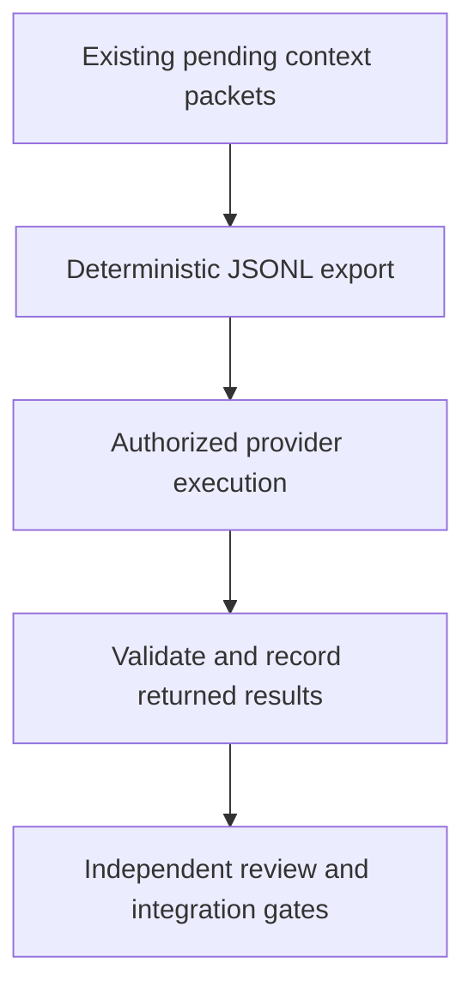

# Meta-wiki: operating costs and discipline

Original estimate: 2026-06-09. Technical guidance reviewed against the repository on 2026-10-26; no provider billing, current price or account allowance was verified.

Operating decisions need a measured period, provider/account, model, usage and
billing evidence. The repository alone does not establish current expenditure,
which component dominates it, or the price of a future run. Keep the applicable
budget and account scope separate from the permission to prepare a proposal.

## Cost components and the historical estimate

The June estimate treated agent sessions as dominant, human review as a
bottleneck, deep reads as cents per source and CI as roughly free. It also
suggested approximately 50% savings through a provider's batch product. These
are historical estimates, not measured costs or guarantees for an installation.
Retain the original period when citing them; verify current terms and actual
usage before a spending decision.

| Component | Evidence to collect | Bounded improvement |
| --- | --- | ---: |
| Agent session | Model, input/output usage, cache behavior and billed period | Reuse retained context where valid; avoid duplicated runs |
| Independent review | Reviewer, scope, elapsed work and resolved findings | One PR = one theme; retain a reviewer distinct from the author |
| Context reading | Source/chunk count, selected model, result quality and measured usage | Reuse valid results; compare authorized execution options |
| Local checks and CI | Enabled jobs, runtime, host/provider allowance and bill | Run applicable gates once per material candidate; do not omit required checks |

The workflow distinguishes deterministic preparation from separately authorized
provider execution and result verification:

## Levers without weakening gates

### Agent session discipline

- Fewer burst sessions: group related work into one session instead of many
  short sessions that rebuild context from scratch.
- Reuse stable instructions and valid retained results. Actual cache eligibility
  and billing depend on the executing provider; a stable prefix alone is not a
  receipt of savings.
- Give the full, well-specified task up front (fewer back-and-forth round trips).

### Budget alert

- Billing is consulted separately (outside the toolkit, to avoid coupling the kit
  to a provider): consult the authorized account's billing/usage surface and
  compare the same period and currency with the agreed budget. Missing access or
  an unverified bill must remain explicit. Do not create grants, accept terms or
  increase a budget merely to complete a check.

### Batch preparation and returned results

- [scripts/wiki_export_batch.py](../../../scripts/wiki_export_batch.py) exports the
  pending context packets in the Message Batches API format, **deterministically
  and without calling any model** (the intelligence stays delegated to the agent
  — see [architecture.md](architecture.md)). Whoever runs the repo submits the
  JSONL and records the results back with
  [scripts/wiki_llm_context_pass.py](../../../scripts/wiki_llm_context_pass.py)
  `--record-result result.json --context system` (replace the context with the
  consumer's configured context). The `custom_id` is the chunk's `cache_key`.
  Export does not submit a batch, authenticate a provider, guarantee that a model
  is available, or prove that the returned result is correct. On the standard
  recording path, the writer validates the result schema and requires its
  `cache_key` to belong to an emitted packet before caching. This membership
  check does not establish semantic equivalence to that packet.
- Check the supported provider workflow and authorized costs before submission.
  A discount does not establish extraction quality; source reading, synthesis,
  independent review and the existing gates remain required.

### Model by profile

- `--model` sets the model identifier in the exported request. It neither
  verifies price/availability nor configures an account-wide model preference.
  Select the model within the task's authorization and qualify the result for
  the source; do not assert lower cost or equivalent quality without evidence.

### Review and CI policy

- The kit requires independent conceptual review by another agent or a human,
  applicable gates and normal CI on the final head, as defined in
  [AGENTS.md](../../../AGENTS.md). Human review is not an extra kit requirement.
- Consumers follow their own policy. A consumer with hosted CI disabled still
  runs its required local checks and records their results. Do not describe an
  absent remote check as a pass or assume that a free allowance applies.

## What does NOT cost tokens

- The honesty gates (auditor, coverage, cockpit `--check`) are **deterministic**
  and do not call a model. They still use local/CI computation and time; that
  distinction does not prove zero monetary cost. Keep semantic reading and
  review explicit outside these deterministic checks. See
  [gates-and-audit.md](gates-and-audit.md).

## Related

- Ingestion flow: [ingestion-flow.md](ingestion-flow.md).
- Command reference: [command-reference.md](command-reference.md).
